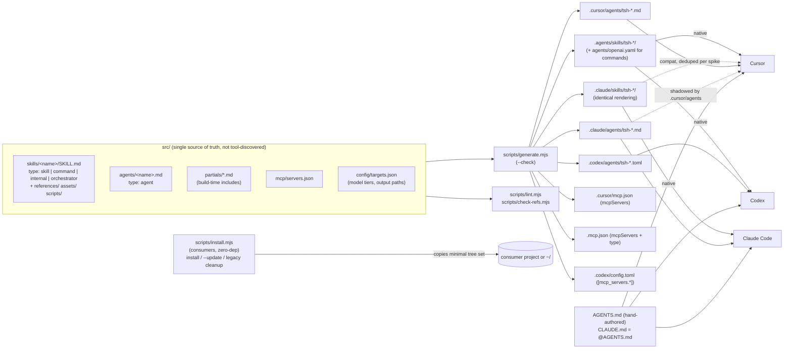

# Unified Agent Structure (Cursor, Claude Code, Codex) - Implementation Plan

## Task Details

| Field            | Value |
| ---------------- | ----- |
| Jira ID          | n/a |
| Title            | Unified agent structure: one neutral source, generated native layouts for Cursor, Claude Code and Codex |
| Description      | Full refactor of `.cursor/`. Replace the Cursor-only category tree with **one tool-neutral source of truth** plus a **generator** that emits native skills, subagents, commands, MCP config and root instructions for Cursor, Claude Code and Codex. Review every one of the 83 current skills and fix structure **and** content (audit findings). |
| Priority         | High (breaking restructure; blocks all further skill work) |
| Related Research | [unified-agent-structure.research.md](./unified-agent-structure.research.md), [audit/agents.audit.md](./audit/agents.audit.md), [audit/commands-internal.audit.md](./audit/commands-internal.audit.md), [audit/workflows.audit.md](./audit/workflows.audit.md) |

**Audit ID convention used throughout this plan**

| Prefix | Source | Example |
|---|---|---|
| `AG-n` / `AG-Xn` | `audit/agents.audit.md` per-skill section *n* / cross-cutting finding X*n* | `AG-10`, `AG-X4` |
| `CI-n` / `CI-CCn` | `audit/commands-internal.audit.md` item *n* / cross-cutting finding *n* | `CI-13`, `CI-CC1` |
| `WF-n` / `WF-CCn` | `audit/workflows.audit.md` per-skill section *n* / cross-cutting § *n* | `WF-15`, `WF-CC1` |
| `R§n` / `R-OQn` | research doc section *n* / open question *n* | `R§2`, `R-OQ1` |

## Proposed Solution

### Summary

1. **Source of truth:** `src/` (not discovered by any tool). Flat: `src/skills/<name>/SKILL.md` (skills, commands, internal steps, orchestrators) and `src/agents/<name>.md` (native subagents), plus `src/mcp/servers.json`, `src/partials/*.md` and `src/config/targets.json`. The artifact type lives in frontmatter (`type:`), not in folder names.
2. **Generator:** `scripts/generate.mjs` (Node ≥ 22, ESM, 2 zero-dependency libraries). It renders the native outputs, and `--check` fails on drift. The lint (`scripts/lint.mjs`) and reference checker (`scripts/check-refs.mjs`) run next to it. A GitHub Actions job runs all three plus the website build.
3. **Outputs are committed** at the repo root in native locations, so the repo dogfoods itself, consumers can copy the files without a build step, and PR diffs stay reviewable:
   - Skills: `.agents/skills/` (read by Cursor and Codex) and `.claude/skills/` (Claude). Both trees get identical renderings.
   - Subagents: `.cursor/agents/*.md`, `.claude/agents/*.md`, `.codex/agents/*.toml`.
   - MCP: `.cursor/mcp.json`, `.mcp.json`, `.codex/config.toml`, all with the correct top-level keys.
   - `AGENTS.md` and `CLAUDE.md` are hand-authored root files.
4. **Cursor duplicate strategy:**
   - Never emit `.cursor/skills/` or `.codex/skills/`.
   - Write byte-identical renderings to both skill trees.
   - The installer picks the minimal tree set per tool combination.
   - For agents, the documented `.cursor/agents` precedence resolves the overlap.
   - A spike (Task 1.1) verifies the remaining unknowns, and a smoke test (Task 5.3) re-verifies them.
5. **Orchestrators run in the main thread as skills:**
   - `tsh-engineering-manager`, `tsh-business-analyst` and `tsh-ai-customization-orchestrator` stay skills.
   - The 17 other personas become native subagents. They **never delegate** (enforced natively where possible: Claude `disallowedTools: [Agent]`).
   - Agents run in **dual mode** (`src/partials/agent-modes.md`):
     - **Interactive** is the default, used when the agent is the main conversation (for example Cursor `/tsh-architect` or `claude --agent tsh-architect`). The agent converses with the user as today.
     - **Delegated** applies only when the delegation prompt starts with the `MODE: delegated` marker. The agent then returns a structured status (`DONE | NEEDS_INPUT | NEEDS_ARCHITECT_DECISION | BLOCKED`) instead of asking.
   - Every delegating command and orchestrator includes `src/partials/caller-status-handling.md`. It handles each status and re-delegates with the prior output and the user's answers.
   - **Upgrade:** the installer detects and removes (backs up) legacy `tsh-*` entries from the old `.cursor/skills/<category>/` install layout, with `--dry-run`. See D3.
   - **Product name:** "TSH AI Collections" (was "Cursor Collections" / "Copilot Collections").
6. **All skill references are by name.** Lint and the reference checker forbid path-based loading.
7. **Naming:**
   - Knowledge skills put the gerund first (`tsh-<gerund>-<object>`) and use American spelling.
   - Commands and internal steps are imperative (`tsh-<verb>[-<object>]`).
   - Agents and orchestrators are role nouns (`tsh-<role>`).
   - `tsh-cursor-*` becomes `tsh-ai-customization-*`.
   - `tsh-engineer-prompt` is folded into the `tsh-prompt-engineer` agent and deleted.
   - The Copilot migration skill is retargeted as `tsh-migrating-copilot-customizations`.
8. **Repo instructions:**
   - `AGENTS.md` replaces `.cursor/rules/cursor-instructions.md` and absorbs `tsh-naming-conventions.mdc`.
   - `CLAUDE.md` contains `@AGENTS.md`.
   - No Cursor rule is needed, because Cursor reads `AGENTS.md` natively.

### Architecture diagram



### Delegation graph after the redesign (at most one delegation level everywhere)

```mermaid
flowchart TD
  U((User)) --> IMPL["/tsh-implement"] & REF["/tsh-refactor"]
  IMPL & REF -->|load skill| EM["tsh-engineering-manager<br/>(orchestrator, main thread)"]
  EM --> CE[tsh-context-engineer] & AR[tsh-architect] & PR[tsh-plan-reviewer] & SE[tsh-software-engineer] & E2E[tsh-e2e-engineer] & DO[tsh-devops-engineer] & PE[tsh-prompt-engineer] & UIR[tsh-ui-reviewer] & CR[tsh-code-reviewer]
  DO -. "returns NEEDS_ARCHITECT_DECISION" .-> EM
  PR -. "returns REVISIONS NEEDED" .-> EM
  U --> AM["/tsh-analyze-materials"] & EXM["/tsh-explore-materials"]
  AM & EXM -->|load skill| BA["tsh-business-analyst<br/>(orchestrator, main thread)"]
  BA --> W1[tsh-ba-transcript-worker] & W2[tsh-ba-analysis-worker] & W3[tsh-ba-extraction-worker] & W4[tsh-ba-quality-worker] & W5[tsh-ba-formatting-worker]
  U --> CC["/tsh-create-custom-{agent,command,rules,skill}"] -->|load skill| AIO["tsh-ai-customization-orchestrator<br/>(main thread)"]
  AIO --> RS[tsh-ai-customization-researcher] & CRT[tsh-ai-customization-creator] & RV[tsh-ai-customization-reviewer]
  U --> RV1["/tsh-review"] --> CR
  U --> RUI["/tsh-review-ui"] --> UIR
  U --> AC["/tsh-audit-codebase"] -->|parallel fan-out from main thread| AR
  U --> ASK["/tsh-ask"] --> AR
  U --> DBG["/tsh-debug"] --> SE
  U --> COST["/tsh-analyze-cloud-costs"] & AI["/tsh-audit-infrastructure"] --> DO
  COST & AI -. "on NEEDS_ARCHITECT_DECISION" .-> AR
  U --> CM["/tsh-commit (standalone, main thread)"]
```



---

### Decision record

#### D1. Source layout and schema

| Option | Pros | Cons |
|---|---|---|
| A. Keep `.cursor/skills/{agents,commands,workflows,internal}` as source, generate the rest | No move | The source is itself discovered by Cursor, which would duplicate the generated `.agents/skills` in this repo. It keeps the category paths that cause 65+ broken path references (CI-CC4). It cannot hold subagents or MCP neutrally. |
| B. `.agents/` as source | Standard-sounding | `.agents/skills` is a **native discovery path** for Cursor and Codex (R§2). Neutral-only frontmatter (`type`, `targets`) would be loaded raw, and it collides with the generated output location. |
| **C. `src/` with a flat `skills/` and `agents/` and type in frontmatter (chosen)** | Not discovered by any tool. Mirrors the Agent Skills layout (folder = identity). The flat layout matches what Claude requires anyway (R§5). `type:` drives the lint rules and rendering. No category paths to reference. | About 60 folders in one directory. Mitigated by name prefixes that group naturally (`tsh-implementing-*`, `tsh-creating-*`) and by the generator's summary output. |
| D. `src/` keeping category sub-folders | Navigation | Duplicates `type:` metadata. Invites path references again. The generator must flatten anyway. |

**Choice: C.** The category folder is replaced by an explicit `type` field that the lint validates. `src/` must never contain directories named `.agents`, `.claude`, `.cursor` or `.codex`: Cursor discovers nested `.cursor/skills` and `.agents/skills` anywhere in a repo (R§1). Test fixtures are written to the OS temp dir for the same reason.

**Source tree**

```
src/
  agents/<name>.md                 # type: agent -> native subagents
  skills/<name>/SKILL.md           # type: skill | command | internal | orchestrator
  skills/<name>/references/*.md    # reading material, worked examples (*.example.md)
  skills/<name>/assets/*           # fill-in output templates (*.template.md)
  skills/<name>/scripts/*          # executables (none today)
  partials/<name>.md               # build-time includes (subagent contract, plan progress)
  mcp/servers.json                 # neutral MCP server list
  config/targets.json              # model-tier map, output paths, owned globs
```

**Skill source frontmatter (exact schema)**

```yaml
---
name: tsh-implement            # REQUIRED. == folder name. ^tsh-[a-z0-9]+(-[a-z0-9]+)*$, <= 64 chars
description: >-                # REQUIRED. <= 1024 chars (lint warns > 500). Third person: what it does + "Use when ...".
  Implements a task end to end from a Jira ID or description ... Use when ...
type: command                  # REQUIRED. skill | command | internal | orchestrator
routes-to: tsh-engineering-manager   # command only. REQUIRED unless standalone: true. Must name an existing agent or orchestrator.
standalone: false              # command only. true = runs in the main thread without routing (tsh-commit only).
argument-hint: "<task-id | description>"   # optional, command only
paths: ["**/*.tf"]             # optional, type skill only. File-glob activation (Cursor + Claude).
requires-mcp: [atlassian, figma]     # optional. Each must exist in src/mcp/servers.json.
license: MIT                   # optional (Agent Skills standard)
metadata:                      # optional, string -> string (Agent Skills standard)
  short-description: "Implement a task end to end"   # <= 120 chars; Codex skill listing
targets:                       # optional escape hatch, merged LAST into the rendered output
  cursor: {}                   # extra SKILL.md keys (e.g. icon, color)
  claude: {}                   # extra SKILL.md keys (e.g. allowed-tools, model, effort)
  codex: {}                    # extra agents/openai.yaml keys (e.g. interface.*)
---
<body: Markdown. May contain <!-- include: <partial-name> --> lines. Skills are referenced by name only.>
```

**Agent source frontmatter (exact schema)**

```yaml
---
name: tsh-code-reviewer        # REQUIRED. == file name without .md. Same charset rule.
description: >-                # REQUIRED. When to delegate to this agent. <= 1024 chars.
  Reviews a change or implementation plan ... Use when ...
type: agent                    # REQUIRED
model-tier: balanced           # REQUIRED. deep | balanced | fast | inherit (mapped via src/config/targets.json)
access: read-write             # REQUIRED. read-only | read-write
shell: true                    # optional, default true
requires-mcp: [atlassian, context7, figma, sequential-thinking]   # optional, must exist in servers.json
preload-skills: [tsh-reviewing-code]   # optional, <= 2 entries. Claude `skills:` preload. Must also be named in the body.
targets:                       # optional escape hatch, merged LAST
  cursor: {}                   # e.g. { model: "...", is_background: true }
  claude: {}                   # e.g. { color: blue, disallowedTools: [...] }
  codex: {}                    # e.g. { model_reasoning_effort: "high" }
---
<body: the agent prompt. MUST include <!-- include: agent-modes -->.>
```

**`src/mcp/servers.json`**

```json
{ "servers": {
  "context7": { "transport": "stdio", "command": "npx", "args": ["-y", "@upstash/context7-mcp@latest"] },
  "figma":    { "transport": "http",  "url": "https://mcp.figma.com/mcp" }
} }
```

**`src/config/targets.json` (model tiers, owned output globs)**

```json
{
  "modelTiers": {
    "deep":     { "cursor": null, "claude": "opus",   "codex": { "model": "gpt-5.4",      "model_reasoning_effort": "high" } },
    "balanced": { "cursor": null, "claude": "sonnet", "codex": { "model": "gpt-5.4",      "model_reasoning_effort": "medium" } },
    "fast":     { "cursor": null, "claude": "haiku",  "codex": { "model": "gpt-5.4-mini" } },
    "inherit":  { "cursor": null, "claude": "inherit","codex": {} }
  },
  "owned": [".agents/skills/tsh-*", ".claude/skills/tsh-*", ".cursor/agents/tsh-*.md",
            ".claude/agents/tsh-*.md", ".codex/agents/tsh-*.toml",
            ".cursor/mcp.json", ".mcp.json", ".codex/config.toml"]
}
```

A `null` Cursor value means the generator omits `model`, so the agent inherits it. The reason: Cursor model availability depends on the plan, and legacy plans ignore `model` (R-OQ12). Codex model ids are carried over from today's `Recommended model` values and are verified in spike 1.3.

**Model mapping from the current blockquotes** (used by the migration script, Task 2.1): `GPT-5.4` and `Gemini 3.1 Pro (Preview)` map to `deep`; `Claude Sonnet 4.6` maps to `balanced`; `GPT-5.4 mini` maps to `fast`.

**Agent metadata targets** (derived from the current `> Recommended tools:` lines and corrected per audit):

| Agent | Tier | Access | Shell | requires-mcp | preload-skills | Notes |
|---|---|---|---|---|---|---|
| tsh-architect | deep | read-write | yes | atlassian, context7, figma, pdf-reader, sequential-thinking | tsh-designing-architecture | "read-only shell" stays prose (AG-1) |
| tsh-software-engineer | deep | read-write | yes | context7, figma, playwright, sequential-thinking | tsh-implement-task | |
| tsh-code-reviewer | balanced | read-write | yes | atlassian, context7, figma, sequential-thinking | tsh-reviewing-code | write only for review notes (AG-4) |
| tsh-context-engineer | deep | read-write | no | atlassian, figma, pdf-reader, sequential-thinking | tsh-analyzing-requirements | |
| tsh-devops-engineer | balanced | read-write | yes | context7, sequential-thinking, awslabs.aws-api-mcp-server, awslabs.aws-documentation-mcp-server, gcp-gcloud, gcp-observability, gcp-storage | tsh-delivering-infrastructure | |
| tsh-e2e-engineer | fast | read-write | yes | context7, figma, playwright, sequential-thinking | tsh-writing-e2e-tests | `atlassian/search` dropped (AG-7) |
| tsh-ui-reviewer | deep | **read-only** | no | context7, figma, playwright, sequential-thinking | tsh-verifying-ui | `edit`/`execute`/`agent` dropped (AG-8) |
| tsh-prompt-engineer | deep | read-write | no | context7, sequential-thinking | tsh-engineering-prompts | |
| tsh-plan-reviewer | deep | read-write | no | context7, sequential-thinking | tsh-reviewing-plans | writes the report file only (AG-10) |
| tsh-ba-transcript-worker | fast | **read-only** | no | pdf-reader | tsh-processing-transcripts | |
| tsh-ba-analysis-worker | deep | **read-only** | no | figma, pdf-reader | tsh-analyzing-requirements | |
| tsh-ba-extraction-worker | balanced | **read-only** | no | sequential-thinking | tsh-extracting-tasks | |
| tsh-ba-quality-worker | deep | **read-only** | no | – | tsh-reviewing-task-quality | |
| tsh-ba-formatting-worker | fast | **read-only** | no | – | tsh-formatting-jira-tasks | |
| tsh-ai-customization-researcher | balanced | **read-only** | no | context7 | – | web fetch allowed |
| tsh-ai-customization-creator | fast | read-write | yes | – | tsh-creating-skills | shell added to run `npm run check` (AG-20) |
| tsh-ai-customization-reviewer | deep | **read-only** | yes | – | – | shell for lint/check only (AG-21) |
| tsh-cursor-engineer | deep | read-write | no | context7, sequential-thinking | – | exists only between Phase 2 and Task 3.28, then deleted |

The table has two cross-cutting rules:

- **Leaf enforcement:** every agent additionally renders `Agent` in Claude `disallowedTools` (D5).
- **BA workers:** all 5 additionally render `mcp__atlassian` in Claude `disallowedTools`. This is documented Claude syntax, so it applies unconditionally, and spike 1.2 confirms it.

#### D2. Generated outputs per tool

| Artifact | Cursor | Claude Code | Codex |
|---|---|---|---|
| Skills (all `type`s) | `.agents/skills/<name>/` (native) | `.claude/skills/<name>/` (native) | `.agents/skills/<name>/` (native) |
| Commands | skill with `disable-model-invocation: true` (Cursor's own `/migrate-to-skills` target; `.cursor/commands` is undocumented, R-OQ7) | skill with `disable-model-invocation: true`, `argument-hint` | skill + `agents/openai.yaml` → `policy.allow_implicit_invocation: false`. Custom prompts are deprecated (R§1). |
| Internal / orchestrator | skill, no flag (model-loadable; visible in `/`, a documented limitation) | skill with `user-invocable: false` (hidden from `/`, still model-loadable) | skill, implicit invocation allowed (default) |
| Subagents | `.cursor/agents/<name>.md`: `name`, `description`, `model` (only if tier maps), `readonly`; body starts with a generated "Required skills" line from `preload-skills` | `.claude/agents/<name>.md`: `name`, `description`, `model`, `disallowedTools` (always includes `Agent`), `skills` | `.codex/agents/<name>.toml`: `name`, `description`, `developer_instructions` (with the same "Required skills" line), `model`, `model_reasoning_effort`, `sandbox_mode` |
| Root instructions | `AGENTS.md` (native). `CLAUDE.md` is also always applied (R§1); it contains only `@AGENTS.md` | `CLAUDE.md` → `@AGENTS.md` (the recommended share pattern) | `AGENTS.md` (native) |
| Scoped rules | none needed. The naming rule moves into `AGENTS.md`, and no rule is distributed to consumers today | none | none |
| MCP | `.cursor/mcp.json` → `mcpServers` (**fixes the `servers` bug**). stdio: `command/args/env`; http: `url` | `.mcp.json` → `mcpServers`; `type: stdio`/`type: http` always emitted (an http entry without `type` is rejected, R§1) | `.codex/config.toml` → `[mcp_servers."<name>"]` (quoted keys; dotted names verified in spike 1.3) |
| Hooks | **out of scope**: the repo has no hooks today | – | – |

**Rendering rules per type (one shared SKILL.md rendering):**

| Source `type` | Frontmatter written to `.agents/skills` **and** `.claude/skills` | Extra files |
|---|---|---|
| `skill` | `name`, `description`, `paths?`, `license?`, `compatibility?`, `metadata?` | – |
| `command` | the above + `disable-model-invocation: true`, `argument-hint?` | `agents/openai.yaml` with `policy.allow_implicit_invocation: false` |
| `internal`, `orchestrator` | the above + `user-invocable: false` | – |

- `compatibility` is rendered from `requires-mcp` as `"Requires MCP servers: a, b"`. It is a standard field, so it is safe for all tools.
- `type`, `routes-to`, `standalone`, `requires-mcp` and `targets` never appear in the output.
- Line 1 of every rendered body is `<!-- Generated from src/skills/<name>/SKILL.md by scripts/generate.mjs. Do not edit. -->`. Frontmatter must stay first, so the comment follows it.
- Bodies never use `$ARGUMENTS`. When the placeholder is absent, Claude appends the arguments automatically, and Cursor and Codex see them as the user message. Command bodies say "the user's input after the command".

**Example: `/tsh-review` rendered for all tools (`.agents/skills/tsh-review/SKILL.md` == `.claude/skills/tsh-review/SKILL.md`)**

```yaml
---
name: tsh-review
description: Reviews a change set or an implemented plan ... Use when ...
disable-model-invocation: true
argument-hint: "[task-id | plan path | free-text scope]"
compatibility: "Requires MCP servers: atlassian"
---
<!-- Generated from src/skills/tsh-review/SKILL.md by scripts/generate.mjs. Do not edit. -->
```

**Example: `tsh-code-reviewer` subagent**

```yaml
# .cursor/agents/tsh-code-reviewer.md          # .claude/agents/tsh-code-reviewer.md
---                                             ---
name: tsh-code-reviewer                         name: tsh-code-reviewer
description: Reviews ...                        description: Reviews ...
---                                             model: sonnet
Required skills: load `tsh-reviewing-code`      disallowedTools: [Agent]
before starting. (generated line)               skills: [tsh-reviewing-code]
<body>                                          ---
```

```toml
# .codex/agents/tsh-code-reviewer.toml
# Generated from src/agents/tsh-code-reviewer.md by scripts/generate.mjs. Do not edit.
name = "tsh-code-reviewer"
description = "Reviews ..."
model = "gpt-5.4"
model_reasoning_effort = "medium"
developer_instructions = """
...body...
"""
```

- Read-only agents get `readonly: true` in Cursor, `disallowedTools: [Write, Edit, NotebookEdit]` in Claude, and `sandbox_mode = "read-only"` in Codex.
- `shell: false` adds `Bash` to Claude's `disallowedTools`. Cursor and Codex have no shell switch, so there the restriction stays prose.
- A deny-list is used instead of a `tools` allow-list so MCP tools stay inherited. That avoids depending on Claude MCP wildcard syntax, which spike 1.2 verifies.
- **Leaf enforcement (M1):**
  - Every Claude agent gets `Agent` in `disallowedTools`, so it cannot spawn nested subagents. Nesting is allowed by default, up to 3 layers (https://code.claude.com/docs/en/sub-agents).
  - Cursor has no per-agent switch; it allows one nesting level since 2.5. Codex is covered by spike 1.3 Q10: if a per-agent config key disables spawning, it is emitted into the TOML.
  - Where no native switch exists, the rule stays prose, plus the `agent-no-delegation` lint.
- **Skill loading inside subagents (M4):**
  - Cursor and Codex agent files have no preload field. The generator therefore prepends a single line to their bodies: "Required skills: load `x` (and `y`) by name before starting."
  - If spike 1.1 Q10 or 1.3 Q9 shows that a subagent cannot load skills by name, `src/config/targets.json` gets `"inlinePreload": ["cursor"]` (or `"codex"`). The renderer then inlines, into that tool's agent file, each preloaded skill's `SKILL.md` body **and the contents of all its `references/` files** (N2). Intra-skill links are rewritten to in-file headings. The inlined text never links to `.agents/` or `.claude/` trees.
- **Honest limits (m4):**
  - For Claude read-only agents with `shell: true` (only `tsh-ai-customization-reviewer`), writes remain possible via the shell.
  - Cursor `readonly` and Codex `sandbox_mode` are not documented to block MCP write tools.
  - The prose restrictions and the Jira-writes-only-in-orchestrator rule remain the primary control there.

**Cursor duplicate-skill strategy (chosen)**

Cursor reads `.cursor/skills`, `.agents/skills`, `.claude/skills` and `.codex/skills`. Claude reads only `.claude/skills`, and Codex only `.agents/skills` (R§2). So no single tree covers all three tools.

| Option | Verdict |
|---|---|
| Emit `.cursor/skills` + `.claude/skills` + `.agents/skills` | Rejected. Guaranteed triple listing in Cursor. |
| Physical `.agents/skills` plus `.claude/skills` as **symlinks** | Rejected as the default. Git on Windows (`core.symlinks=false`), zip downloads and Cursor GitHub import may break symlinks. Cursor symlink handling is unverified (R-OQ2). Kept as a spike variant only. |
| Claude via plugin only (outside the repo tree) | Rejected as the default. Namespaced `/plugin:skill` names, no CLAUDE.md, needs a marketplace. Kept as an optional extra (see Improvements). |
| **Two real trees with byte-identical renderings, no `.cursor/skills` or `.codex/skills`, plus a minimal-tree installer (chosen)** | Claude and Codex are always correct. Cursor sees at most two identical copies. The installer avoids even that for every combination except "Cursor + Claude + Codex". |

Installer tree selection (`scripts/install.mjs`, Task 2.7):

| Tools selected | Skill trees installed | Why |
|---|---|---|
| cursor | `.agents/skills` | native |
| claude | `.claude/skills` | native |
| codex | `.agents/skills` | native |
| cursor + claude | `.claude/skills` only | Cursor reads it through compat (on by default) |
| cursor + codex | `.agents/skills` only | shared native path |
| claude + codex | both | Cursor not involved |
| cursor + claude + codex (and this repo itself) | both | Relies on the spike 1.1 result. If Cursor lists duplicates, the docs instruct turning off Cursor's "Include Third-Party Plugins, Skills, and Other Configs" setting. Cursor then reads `.agents/skills` and `.cursor/agents` natively only. |

- **Agents need no dedupe work.** `.cursor/agents` beats `.claude/agents` on a name clash (documented, R§1).
- **Unknowns and how they are verified:** Cursor handling of `.codex/agents/*.toml` (R-OQ6), duplicate identical skills (R-OQ1) and unknown frontmatter keys (R-OQ3) are all spike 1.1 items.
- **Fallback if Cursor rejects the unknown keys** (`user-invocable`, `argument-hint`): split into two renderings. Claude keys go only into `.claude/skills`; `.agents/skills` gets Cursor/Codex keys only. This is a small, isolated change in `render-skills.mjs`, recorded in the Changelog.
- **Re-verification:** smoke test 5.3 checks that each `tsh-*` skill appears exactly once in Cursor's `/` palette.

#### D3. Committed vs. built; distribution

| Option | Pros | Cons |
|---|---|---|
| **Commit the generated outputs at the repo root (chosen)** | Consumers need no build. The repo dogfoods itself in all 3 tools. PR diffs show the real native output. Cursor GitHub import keeps a chance to work. | Generated churn in PRs, mitigated by `.gitattributes linguist-generated=true` and the CI `--check` job. |
| Build at install time | Smaller diffs | Every consumer needs Node + `npm ci`. No dogfooding. GitHub import is impossible. |
| Commit to `dist/<tool>/` | Clear separation | No dogfooding. The consumer path gets longer. Tools do not read `dist/`. |

**Consumer distribution path:**

1. **Clone + installer (primary):**
   - Run `git clone … ~/cursor-collections` and then `node ~/cursor-collections/scripts/install.mjs --tools cursor,claude,codex --scope user|project [--project-dir <dir>] [--dry-run] [--force]`.
   - The installer has no dependencies (Node `fs` only). Node is already a de-facto prerequisite, because most MCP servers run through `npx`.
   - It writes and removes only `tsh-*` entries, plus its own manifest file `.tsh-install-manifest.json` in each target root. The manifest records the installed names, tools and source commit.
   - **Copy is the only default mode (M7).** `--mode link` (symlinks, today's "update with `git pull`" workflow) is implemented only if spike 1.1(b) confirms that Cursor handles symlinked skill dirs. If it does not, the flag is not shipped.
   - **Updating:** run `git -C ~/cursor-collections pull && node ~/cursor-collections/scripts/install.mjs --update`. `--update` reads the manifests, re-copies every installed tool tree, and prunes `tsh-*` entries it installed earlier that no longer exist (renamed or deleted artifacts). Pruning and `--force` overwrites **move real directories to the backup and never hard-delete them**; symlinks are simply removed (N3).
   - MCP is **not** merged into user configs automatically. The installer prints which generated file to copy or merge for each tool (safety, see Security).
   - **Legacy cleanup (B1)** runs by default on install and update, and on its own with `--migrate-legacy`. It supports `--dry-run`.
     - **Where it scans:**
       - `~/.cursor/skills/` and `<project>/.cursor/skills/`, which the old README and website told users to symlink or copy into
       - every target skills dir (`~/.agents/skills`, `~/.claude/skills`, and their project equivalents)
     - **What counts as legacy** (only `tsh-*` entries):
       - (a) **every** `tsh-*` entry directly under `~/.cursor/skills/` or `<project>/.cursor/skills/`, whatever its name or target. The new layout never installs there (N1).
       - (b) copied **category-folder trees** under those two dirs: `agents/`, `commands/`, `workflows/` or `internal/` containing `tsh-*` entries. They are reported, and the `tsh-*` entries inside them are backed up (N1).
       - (c) in the other target skills dirs: a symlink that is dangling or points into a `…/.cursor/skills/{agents,commands,workflows,internal}/` path, or an entry whose name is in `scripts/legacy-names.json`.
     - **`scripts/legacy-names.json`** is committed permanently. It contains every old name from the D7 rename map, every deleted artifact, and the 17 persona names that are now subagents (for example `tsh-architect` as a *skill*, which would shadow the new subagent; AG-X6).
     - **What happens to a match:** symlinks are removed. Real directories (copies, possibly edited by the user) are **moved** to `~/.tsh-ai-collections-backup/<timestamp>/`, never deleted. The move uses `rename`, and falls back to copy + remove when `rename` fails with `EXDEV` (cross-device) (N6).
     - **Report:** the installer prints each action.
     - **Scope:** non-`tsh` entries are never touched. In the new target dirs, current skill names (including the orchestrators) are not treated as legacy.
   - **Upgrade docs:** a new website page `getting-started/upgrading.md`, a README "Upgrading" section and a CHANGELOG "Upgrading" subsection. They give the one-command path (`install.mjs --dry-run`, then `install.mjs`), the manual equivalent (`find ~/.cursor/skills -maxdepth 1 -name 'tsh-*' -type l -delete`, then remove the listed legacy dirs), and the GitHub-import path (remove the old Remote Rule, then re-import or switch to the installer).
   - **Renamed commands:** there are no aliases or deprecation stubs (user decision, OQ3). The breaking change is documented only in the CHANGELOG migration table.
2. **Cursor GitHub import (secondary):** kept in the docs only if spike 1.1 confirms it picks up `.agents/skills` and `.cursor/agents`. Otherwise it is removed from the docs.
3. **Optional extras (not in scope):** Claude plugin marketplace (`.claude-plugin/marketplace.json`), Cursor plugin (`.cursor-plugin/plugin.json`), the Agent Plugins root `plugin.json`, `npx skills add`. The generated layout is already plugin-shaped (`skills/`, `agents/`), so adding them later only needs manifests.

#### D4. Generator technology

| Option | Verdict |
|---|---|
| Bash | Rejected. It cannot parse YAML frontmatter or emit TOML safely, and has poor testability. |
| **Node ≥ 22 ESM, root `package.json`, dependencies `yaml` + `smol-toml` (both zero-transitive), tests with `node:test` (chosen)** | Node is already present (Docusaurus `website/`, MCP `npx`). No TypeScript build step: plain `.mjs` with JSDoc. |
| TypeScript | Rejected. It adds a build step for a small script set. |

- **Scripts:**
  - `npm run generate` writes the outputs.
  - `npm run check` runs `generate --check`, `lint` and `check-refs`, and exits non-zero on any drift or finding.
  - `npm test` runs the unit tests.
- **Consumer scope:** `scripts/install.mjs` is kept dependency-free so consumers never need `npm ci`.
- **CI:** `.github/workflows/validate.yml` (Task 5.1).

#### D5. Subagent nesting and delegation redesign

**Corrected rationale (M1).** The audit claim (AG-X1) that Claude subagents cannot spawn subagents is wrong:

- **Claude** allows nesting up to 3 layers by default (https://code.claude.com/docs/en/sub-agents).
- **Cursor** allows one nesting level since 2.5.
- **Codex's** depth limit is unknown (spike 1.3 Q4).

**One delegation level everywhere** is chosen as the lowest common denominator across the three tools. It is also the simplest model to reason about, test and document. It is enforced natively where possible (Claude `disallowedTools: [Agent]`; see D2) and otherwise by prose plus lint:

- **Orchestrators are main-thread skills.** They are `type: orchestrator`, loaded by name from commands:
  - `tsh-engineering-manager`, loaded by `/tsh-implement` and `/tsh-refactor`
  - `tsh-business-analyst`, loaded by `/tsh-analyze-materials` and `/tsh-explore-materials`
  - `tsh-ai-customization-orchestrator`, loaded by `/tsh-create-custom-*`
  - None of them is ever emitted as a subagent, so no skill/subagent name clash can occur (AG-X6).
- **Leaf agents never delegate. They run in dual mode (user decision, M3).** Every agent includes `src/partials/agent-modes.md`, which defines:
  - **Mode detection is explicit, with no heuristics.** An agent is in **delegated mode** only if the first line of the task it receives is exactly `MODE: delegated`. Otherwise (a user invoked it directly: Cursor `/tsh-architect`, `claude --agent tsh-architect`, "use the tsh-architect agent", Codex) it is in **interactive mode**. Interactive is the default.
  - **Interactive mode:** behave as today. Converse with the user, ask clarifying questions directly, and present results. The `Suggested next steps` list is shown to the user.
  - **Delegated mode:**
    - Never ask the user.
    - End with a fenced status block: `STATUS: DONE | NEEDS_INPUT | NEEDS_ARCHITECT_DECISION | BLOCKED`, plus `ARTIFACTS:` (paths), `SUMMARY:`, `QUESTIONS:` (for NEEDS_INPUT), `DECISION_NEEDED:` (for NEEDS_ARCHITECT_DECISION) and `BLOCKER:` (for BLOCKED).
    - The override rule: "If a loaded skill tells you to ask the user, add the question to QUESTIONS and return instead."
    - **Persist partial work before returning.** Drafts and findings go to files listed in `ARTIFACTS`, so a re-delegation continues instead of starting over.
  - **Interactive agent without an ask-user tool (N4):** end the reply with a numbered "Questions for you" list, then wait for the user's answers.
  - **Resuming:** if the delegation prompt contains `PRIOR_OUTPUT:` and `USER_ANSWERS:` sections, continue from them.
  - This one partial resolves the contradictions in devops (AG-6), e2e (AG-7), ui-reviewer (AG-8), the context-engineer question policy (AG-5) and the BA workers' ask-steps (AG-X4). It also keeps today's interactive persona use.
- **The caller side is one shared partial too (M2).** `src/partials/caller-status-handling.md` is included by every orchestrator and by every command whose `routes-to` is an agent: `/tsh-review`, `/tsh-review-ui`, `/tsh-ask`, `/tsh-debug`, `/tsh-audit-codebase`, `/tsh-analyze-cloud-costs` and `/tsh-audit-infrastructure`. A lint rule enforces this (`caller-status-handling`, Task 1.11). The partial defines:
  - **The delegation prompt template:** `MODE: delegated`, `CALLER: <name>`, `TASK:`, `INPUT_ARTIFACTS:` (explicit paths) and, on re-delegation, `PRIOR_OUTPUT:` (the previous STATUS block verbatim) and `USER_ANSWERS:`.
  - **Handling per status:**
    - `DONE`: continue.
    - `NEEDS_INPUT`: ask the user the listed questions in the main thread, then re-delegate to the same agent with `PRIOR_OUTPUT` + `USER_ANSWERS`.
    - `NEEDS_ARCHITECT_DECISION`: delegate `tsh-architect` with `DECISION_NEEDED`, then re-delegate the original agent with the decision in `PRIOR_OUTPUT`.
    - `BLOCKED`: surface the blocker to the user and stop that branch.
    - Missing or unparsable STATUS: treat as `BLOCKED`, and show the raw output.
  - **Iteration cap:** at most 3 re-delegations per agent per task, then escalate to the user. EM's plan-review loop (3) and UI loop (5) keep their own documented caps.
- **The orchestrators own the loop:**

  | Concern | Loop owner | Replaces |
  |---|---|---|
  | Plan review → architect revision | EM | plan-reviewer `:195` (AG-10) |
  | E2E → code review | EM | `tsh-implement-e2e:89` (CI-21) |
  | Devops → architect escalation | EM, or the cost/audit command in the main thread | devops spawning the architect (AG-6, CI-18, CI-22, CI-23, CI-24) |
  | UI verify-fix loop | EM, via `tsh-orchestrate-ui-verification` | (CI-26) |
  | Parallel architect fan-out | `/tsh-audit-codebase` in the main thread | architect spawning architects (CI-16) |
- **Handoffs become text.** Every `Invoke @x with /y` becomes a `## Suggested next steps` list naming a **command** (for example "run `/tsh-review`"), shown to the user by the caller. The wrong targets are fixed: code-reviewer and e2e handed off to SE with `/tsh-implement`, which actually routes to EM; the ui-reviewer handoff is removed.
- **Artifact paths.** The orchestrators pass explicit artifact paths to delegates (`specifications/<task>/<task>.research.md`, `.plan.md`, `.plan-review.md`). The EM is the single owner of the naming convention, which removes its duplication in `tsh-plan:10` and `tsh-research:10` (CI-27, CI-28).
- **Direct persona use.** Today users chat with `@tsh-architect` as a persona. After the redesign they invoke the agent directly, using each tool's native syntax, and get **interactive mode** (see above).
  - Examples: Claude `claude --agent tsh-architect` (fully conversational in the main thread), or "use the tsh-architect agent".
  - Spikes 1.1–1.3 confirm the syntax per tool, and whether a directly invoked Cursor or Codex subagent can hold a multi-turn conversation.
  - Where it cannot, `supported-tools.md` documents the limitation (Task 4.2). Consultative use then goes through `/tsh-ask`, which runs in the main thread, talks to the user and delegates only the analysis.
  - The syntax is documented per tool in Task 4.2.

#### D6. Hidden-but-loadable internal steps

| Neutral `type` | Cursor | Claude Code | Codex | Loaded by |
|---|---|---|---|---|
| `skill` (knowledge) | auto-invocable | auto-invocable | implicit allowed | any agent, by name |
| `command` | `disable-model-invocation: true` | `disable-model-invocation: true` | `allow_implicit_invocation: false` | user only |
| `internal` | no flag (Cursor cannot hide from `/` and still stay model-loadable; documented) | `user-invocable: false` | implicit allowed | an orchestrator or agent, by name |
| `orchestrator` | as `internal` | as `internal` | as `internal` | a command, by name |

**Consequences:**

- Today's `disable-model-invocation: true` on the 11 internal skills and the 9 delegate-only agents is removed. It is the reason those skills could only be loaded by path (CI-CC1).
- **Evidence for the Claude mapping.** https://code.claude.com/docs/en/skills confirms that unlisted (`user-invocable: false`) skills stay invocable through the Skill tool, including from subagents. Preload cannot target `disable-model-invocation: true` skills, and this plan never preloads a command. Spike 1.2 Q1/Q2 are confirmation only.
- **Limitation in Cursor and Codex (m3).** Neither tool can hide `internal`/`orchestrator` skills: they appear in Cursor `/` and Codex `$`/`/skills`, and can be auto-invoked. To limit accidental auto-invocation, the descriptions of these two types start with "Internal step of `/tsh-…`: load only when a tsh command or orchestrator instructs it." This is a deliberate exception to CI-CC12 for these two types only. Task 4.2 documents the limitation for both tools.
- **Dual-use commands are resolved by moving their bodies into knowledge skills.** Delegates load the knowledge skill by name, and the command stays a thin, user-only router:

  | Command | Body moves into |
  |---|---|
  | `/tsh-review` | `tsh-reviewing-code` |
  | `/tsh-review-ui` | `tsh-verifying-ui` |
  | `/tsh-audit-codebase` | `tsh-analyzing-codebase` |

  This resolves CI-CC2.
- **Path-based loading is banned.** The lint rule `no-path-refs` rejects:
  - `.cursor/skills/`
  - `…/SKILL.md` links
  - `../` links out of a skill
  - `read_file` + path
  - `[..](.cursor/...)`

  A skill may link only to its own `references/`, `assets/` and `scripts/` files, one level deep. All other skills are referenced as "load the `tsh-x` skill" (CI-CC4, AG-X3, WF-CC6).

#### D7. Naming

| Topic | Decision | Rationale |
|---|---|---|
| Gerund word order (WF-CC3) | **Knowledge skills are `tsh-<gerund>-<object>`**, gerund first. A single gerund is allowed (`tsh-committing`, `tsh-debugging`). American spelling (`analyzing`). | 21 of 34 names are already gerund-first. It matches Agent Skills naming guidance and `tsh-creating-skills`. American spelling matches `/tsh-analyze-*` and `optimizing`. The refactor already rewrites every reference, so this is the cheapest moment to rename. |
| Commands, internal steps | `tsh-<verb>[-<object>]` imperative | Existing convention (`tsh-implement`, `tsh-review`) |
| Agents, orchestrators | `tsh-<role>` noun | Existing convention |
| `tsh-cursor-*` | `tsh-ai-customization-{orchestrator,researcher,creator,reviewer}`; `tsh-cursor-engineer` is deleted | Tool-neutral (AG-X6). The engineer duplicates the orchestrator's quick path, and its A/B experiment has no end criterion (AG-17 `:28`, AG-18). |
| `tsh-engineer-prompt` | **Folded into the `tsh-prompt-engineer` agent and deleted** | Removes the confusing triad. It is a 32-line wrapper whose loop and output format belong in the agent body (AG-X6, CI-19). |
| Copilot migration skill | **Retarget** to `tsh-migrating-copilot-customizations`: Copilot `.github/*` → native Cursor/Claude/Codex files, or → `src/` when a neutral source exists | Upstream Copilot PRs are still being ported (commits `5049d6c`…`324d2fd`). Consumers with Copilot setups benefit too (WF-23). |
| Support files (WF-CC1, WF-CC2) | Only `SKILL.md`, `references/`, `assets/` and `scripts/` are allowed in a skill dir. Fill-in templates go to `assets/<name>.template.md`; worked examples go to `references/<name>.example.md`. Files over 100 lines start with `## Contents`. No cross-skill file references. | Agent Skills standard layout, enforced by lint |
| Size | `SKILL.md` ≤ 500 lines. Splits: `tsh-implementing-backend` (526), `tsh-designing-databases` (1229). Content moves out of `tsh-engineering-prompts` (422), `tsh-reviewing-task-quality` (345), `tsh-business-analyst` (298) and `tsh-plan-reviewer` (243). | Progressive disclosure |
| Collisions | Lint: no skill name may equal an agent name. `routes-to` must resolve. | AG-X6 |
| Product name (OQ1) | **TSH AI Collections**, applied to the README title, `website/docusaurus.config.ts` `title`/`tagline`, `website/package.json` `name` (`tsh-ai-collections-docs`) and the CHANGELOG. The GitHub repo slug (`cursor-collections`) and the website domain (`copilot-collections.tsh.io`) stay; renaming them is a repo-owner action outside this repo (see Improvements). | The name is tool-neutral and keeps the TSH origin. The `tsh-` prefix still matches it. |

**Rename map** (applied mechanically in Task 2.1; also listed in the CHANGELOG migration table):

| Old | New | Kind |
|---|---|---|
| tsh-architecture-designing | tsh-designing-architecture | skill |
| tsh-code-reviewing | tsh-reviewing-code | skill |
| tsh-codebase-analysing | tsh-analyzing-codebase | skill |
| tsh-e2e-testing | tsh-writing-e2e-tests | skill |
| tsh-implementation-gap-analysing | tsh-analyzing-implementation-gaps | skill |
| tsh-jira-task-formatting | tsh-formatting-jira-tasks | skill |
| tsh-sql-and-database-understanding | tsh-designing-databases | skill |
| tsh-task-analysing | tsh-analyzing-requirements | skill |
| tsh-task-extracting | tsh-extracting-tasks | skill |
| tsh-task-quality-reviewing | tsh-reviewing-task-quality | skill |
| tsh-technical-context-discovering | tsh-discovering-technical-context | skill |
| tsh-transcript-processing | tsh-processing-transcripts | skill |
| tsh-ui-verifying | tsh-verifying-ui | skill |
| tsh-migrating-copilot-to-cursor | tsh-migrating-copilot-customizations | skill |
| tsh-cursor-orchestrator | tsh-ai-customization-orchestrator | orchestrator |
| tsh-cursor-researcher | tsh-ai-customization-researcher | agent |
| tsh-cursor-artifact-creator | tsh-ai-customization-creator | agent |
| tsh-cursor-artifact-reviewer | tsh-ai-customization-reviewer | agent |
| tsh-review-codebase | tsh-audit-codebase | command |
| tsh-analyze-aws-costs | tsh-analyze-cloud-costs (GCP merged in 3.18) | command |
| tsh-implement-common-task | tsh-implement-task | internal |
| tsh-implement-ui | tsh-orchestrate-ui-verification | internal |

#### D8. The repo's own always-on instructions

| Option | Verdict |
|---|---|
| Keep `.cursor/rules/cursor-instructions.md` | Rejected. A plain `.md` file in `.cursor/rules` is **ignored by Cursor** (R§5). Claude and Codex do not read it. |
| Generate rules from `src/rules/` | Rejected (YAGNI). No rule is distributed to consumers. The only scoped rule (naming, 30 lines) fits into AGENTS.md. |
| **Hand-authored root `AGENTS.md` (constitution + naming + authoring workflow + commit conventions); `CLAUDE.md` containing only `@AGENTS.md`; delete `.cursor/rules/` (chosen)** | All 3 tools read AGENTS.md: Cursor and Codex natively, Claude through the import (R§1). Spike 1.1 checks whether Cursor also expands the `@AGENTS.md` line in CLAUDE.md, which would apply the content twice. The worst case is harmless duplication of a ~120-line file. If Cursor does not expand the import, the one-line CLAUDE.md is harmless. If it does, the duplicate is about 150 lines, which is acceptable. The only fallback, used if duplication causes real problems, is to **delete `CLAUDE.md`**. Claude Code (v2.1.277+) reads `AGENTS.md` natively when no CLAUDE.md exists (R§1), so every tool then reads exactly one file (m1). |

---

### Per-skill change table (all 83 current skills)

- The current paths are relative to `.cursor/skills/`, and the new paths are relative to `src/`.
- **Type** is the neutral `type`. **Sev** comes from the audit and is upgraded where this plan adds a merge.
- **Every row also gets the Phase 2 mechanical changes:** the move, the frontmatter conversion, name-based references, and the support-file layout. For content rows that is implicit in Tasks 2.1/2.2 and is not repeated below.
- Most rows also get the scripted Phase 3 passes: 3.1 (neutral wording), 3.2 (section normalization), 3.3 (partials, agents only) and 3.5 (handoffs).

#### Agents (21)

| # | Current path | New source path | Type | New name | Concrete changes (audit refs) | Sev | Tasks |
|---|---|---|---|---|---|---|---|
| 1 | agents/tsh-architect/SKILL.md | agents/tsh-architect.md | agent | – | Tier deep, rw, shell (AG-X3). Drop "Invoke with @", the skill-check boilerplate (AG-X8), `grep_search`, `*.mdc` and Figma "Dev Mode" (AG-1). Handoffs → Suggested next steps (AG-X1). MCP blocks → `tsh-using-mcp-servers` (AG-X5). Planning procedure from `tsh-designing-architecture` (absorbs `tsh-plan`, CI-27). Return contract. | minor | 2.2, 3.1, 3.3–3.5, 3.11, 3.15 |
| 2 | agents/tsh-software-engineer/SKILL.md | agents/tsh-software-engineer.md | agent | – | Tier deep, rw, shell. Preload `tsh-implement-task`. Remove the `tsh-implement-e2e` path (`:155`; E2E is EM's job). Plan-progress partial (AG-X5). "Collaborate with QA/architect" → return contract (AG-2). `usages` → generic. Name `tsh-discovering-technical-context`. | minor | 3.3, 3.5, 3.8, 3.15 |
| 3 | agents/tsh-engineering-manager/SKILL.md | skills/tsh-engineering-manager/SKILL.md | orchestrator | – | Main thread (AG-X1). Absorbs Step 0 + Quick/Full flows from `/tsh-implement` (CI-13). Delegate by subagent name; "Task tool" and model names removed (`:27,:61,:129`). Add the missing code-reviewer delegation block (AG-3). UI gate → one pointer to `tsh-orchestrate-ui-verification`. Owns the plan-review loop, E2E→review, devops escalation, `NEEDS_INPUT` handling, artifact-path convention, Quick-flow review without a plan (CI-13), and refactor mode. Long flows → `references/`. | major | 3.6, 3.7, 3.9 |
| 4 | agents/tsh-code-reviewer/SKILL.md | agents/tsh-code-reviewer.md | agent | – | Tier balanced, rw (review notes only), shell, no `agent` tool (AG-4). Preload `tsh-reviewing-code`. Fix the handoff target (AG-4, CI map). Move the LLM-code detection heuristic (`:41`) to `tsh-reviewing-code`. Neutral rules wording (`:30`). Figma wording (`:77`). | minor | 3.15, 3.34 |
| 5 | agents/tsh-context-engineer/SKILL.md | agents/tsh-context-engineer.md | agent | – | Tier deep, rw, no shell. Delete the copy-pasted `:25`. "One question at a time" → return `NEEDS_INPUT` (AG-5). Reference `tsh-analyzing-requirements` by name (absorbs `tsh-research`, `:35`). Figma wording (`:64`). | minor | 3.12 |
| 6 | agents/tsh-devops-engineer/SKILL.md | agents/tsh-devops-engineer.md | agent | – | Tier balanced, rw, shell, 5 cloud MCPs. Remove the architect spawn (`:37,:47-79,:128,:138-148`) → `NEEDS_ARCHITECT_DECISION` (AG-6). Resolve the interactivity contradiction (`:36` vs `:123-126,:220-229`) through the contract. Move the discovery lists, output strategy, FinOps threshold and skill-loading table → `tsh-delivering-infrastructure`. Absorb the routing of the 4 deleted devops internals. Define the "Zero-Deletion Policy" that cost commands reference but that does not exist (CI-1 `:196`). Target < 120 lines. | major | 3.16, 3.17 |
| 7 | agents/tsh-e2e-engineer/SKILL.md | agents/tsh-e2e-engineer.md | agent | – | Tier fast, rw, shell, drop `atlassian/search` (AG-7). Absorb the `tsh-implement-e2e` steps (CI-21). Remove the E2E standards duplicate (`:49-73`; the canonical copy is in `tsh-writing-e2e-tests`). Non-interactive through the contract. Fix the handoff (`:150`). Load `tsh-analyzing-requirements` only when no plan is given (`:45`). | minor | 3.13 |
| 8 | agents/tsh-ui-reviewer/SKILL.md | agents/tsh-ui-reviewer.md | agent | – | Tier deep, **read-only**, no shell (AG-8). Preload `tsh-verifying-ui`. Fix the caller (EM, not SE, `:13`). Remove the handoff (`:90`). One blocker policy: return a partial report with `BLOCKED`/`NEEDS_INPUT` (`:21-29`). | minor | 3.9, 3.36 |
| 9 | agents/tsh-prompt-engineer/SKILL.md | agents/tsh-prompt-engineer.md | agent | – | Tier deep, rw, no shell. Absorb the `tsh-engineer-prompt` 5-step loop and output format (CI-19). Boundary `:25` → "AI-tool customization belongs to `/tsh-create-custom-*`". Trim the persona prose (`:27-41`, AG-X5). | minor | 3.14, 3.28 |
| 10 | agents/tsh-plan-reviewer/SKILL.md | agents/tsh-plan-reviewer.md | agent | – | Tier deep, rw (report file only), no shell, drop `disable-model-invocation` (AG-10). Challenge domains, severity table, 10-step workflow and output template → new `tsh-reviewing-plans`. Body about 60 lines. `:195` "ALWAYS send to architect" → return the verdict + report path. `*.mdc` (`:63`). | major | 3.10 |
| 11 | agents/tsh-business-analyst/SKILL.md | skills/tsh-business-analyst/SKILL.md (+ references/parallel-processing.md) | orchestrator | – | Main thread (AG-11). Owns every Save/Ask/Jira step (AG-X4). Parallel strategy `:101-194` → `references/parallel-processing.md`. Protected-status policy `:73-90` → `tsh-guarding-jira-statuses`. Case B names `tsh-ba-analysis-worker`. Description adds Gate 1.5 + "Use when". Move `## Constraints` out of Tool Usage (`:224-230`). Model names → worker tiers (`:42-46`). Neutral Office-file claim (`:127`). EM handoff → suggestion (`:23`). About 120 lines. | major | 3.20–3.22 |
| 12 | agents/tsh-ba-transcript-worker/SKILL.md | agents/tsh-ba-transcript-worker.md | agent | – | Tier fast, **read-only**, pdf-reader (AG-12). Compact the blank lines. Runs `tsh-processing-transcripts` in delegated mode (AG-X4). Return contract. | minor | 3.20, 3.23 |
| 13 | agents/tsh-ba-analysis-worker/SKILL.md | agents/tsh-ba-analysis-worker.md | agent | – | Tier deep, read-only, figma + pdf-reader (AG-13). States that it handles per-document analysis for BA Case B. `tsh-analyzing-requirements` in delegated mode (no Jira). | minor | 3.20, 3.23 |
| 14 | agents/tsh-ba-extraction-worker/SKILL.md | agents/tsh-ba-extraction-worker.md | agent | – | Tier balanced, read-only (AG-14). Documents the "per-epic slice" input contract. `tsh-extracting-tasks` in delegated mode. | minor | 3.20, 3.23 |
| 15 | agents/tsh-ba-quality-worker/SKILL.md | agents/tsh-ba-quality-worker.md | agent | – | Tier deep, read-only (AG-15). `tsh-reviewing-task-quality` in delegated mode (no Atlassian, no ask, no save). | minor | 3.20, 3.23 |
| 16 | agents/tsh-ba-formatting-worker/SKILL.md | agents/tsh-ba-formatting-worker.md | agent | – | Tier fast, read-only (AG-16). Formatting/verification only; push and import stay with the orchestrator (split in `tsh-formatting-jira-tasks`). | minor | 3.20, 3.23, 3.24 |
| 17 | agents/tsh-cursor-orchestrator/SKILL.md | skills/tsh-ai-customization-orchestrator/SKILL.md | orchestrator | tsh-ai-customization-orchestrator | Main thread, renamed (AG-17). Remove the A/B note (`:28`). Remove the domain block (`:74-87`) → load `tsh-creating-*`. The workspace structure (`:85`) references the source layout in `tsh-creating-skills`. Neutral delegation and UI wording (`:15,:54,:92`). Adds a "quick mode" (single small edit done inline), which replaces `tsh-cursor-engineer`. | major | 3.28 |
| 18 | agents/tsh-cursor-engineer/SKILL.md | **deleted** | – | – | **Delete** (AG-18 option d). The corrected SoC model goes into `tsh-creating-agents`/`tsh-creating-skills` (`:50` contradiction fixed to "agents load workflows"). Single-pass behavior → orchestrator quick mode. Persona prose dropped. Inbound references updated (`tsh-prompt-engineer:25`, docs). | major | 3.27, 3.28 |
| 19 | agents/tsh-cursor-researcher/SKILL.md | agents/tsh-ai-customization-researcher.md | agent | tsh-ai-customization-researcher | Tier balanced, read-only (AG-19). Docs sources: Cursor, Claude Code, Codex, Agent Skills spec. Drop the "prompt/instruction files" Copilot vocabulary (`:17`). Keep the output contract. | minor | 3.29 |
| 20 | agents/tsh-cursor-artifact-creator/SKILL.md | agents/tsh-ai-customization-creator.md | agent | tsh-ai-customization-creator | Tier fast, rw, shell (AG-20). Target `src/` when the project has a neutral source, otherwise native paths per tool. Run `npm run generate && npm run check` after editing in such repos. Drop `create_file` (`:54`) and the `.mdc`/`cursor-instructions.md` references (`:35`). | major | 3.29 |
| 21 | agents/tsh-cursor-artifact-reviewer/SKILL.md | agents/tsh-ai-customization-reviewer.md | agent | tsh-ai-customization-reviewer | Tier deep, read-only, shell (AG-21). Retarget to the source layout. Redefine "Tool Configuration Appropriateness" (`:40`) for `access`/`shell`/`requires-mcp`. Add a "Portability" dimension (no tool syntax in the source, names resolve). "prompt" → "command" (`:19`). | major | 3.29 |

#### Commands (17)

| # | Current path | New source path | Type | New name | Concrete changes (audit refs) | Sev | Tasks |
|---|---|---|---|---|---|---|---|
| 22 | commands/tsh-analyze-aws-costs/SKILL.md | skills/tsh-analyze-cloud-costs/SKILL.md | command | tsh-analyze-cloud-costs | Merge AWS + GCP; `argument-hint: "<aws|gcp> <profile|project> <region>"`; `routes-to: tsh-devops-engineer` (CI-1). `read_file` + paths → skill names (`:28-32`). Checklist `:52-62`, tags `:64-70` and report template `:83-177` → `tsh-optimizing-cloud-cost` references/assets. **Bug:** "step 7" → step 8 (`:45`). **Broken ref:** "Zero-Deletion Policy" (`:196`), now defined in devops (3.16). Duplicate required-skills list removed. Report → `specifications/cost-audits/<provider>-<yyyy-mm-dd>.md`. The command handles `NEEDS_ARCHITECT_DECISION`. | major | 2.1, 3.18 |
| 23 | commands/tsh-analyze-gcp-costs/SKILL.md | **merged** into skills/tsh-analyze-cloud-costs | – | – | **Delete after merge** (CI-2). Same step bug (`:47`). The GCP label mapping moves to `tagging-standards.md` (`:69`). Drop the weak multi-cloud reference (`:32`). The GCP checklist → `references/gcp-audit-checklist.md`. | major | 3.18 |
| 24 | commands/tsh-analyze-materials/SKILL.md | skills/tsh-analyze-materials/SKILL.md | command | – | Thin: `routes-to: tsh-business-analyst`, "load the `tsh-business-analyst` skill" (CI-3). Keep only entry-point detection (materials vs Jira keys vs explore) and the output-folder convention. Delete the 14-step duplicate (`:40-53`) and the artifact list (`:11-18`). `@` → neutral (`:9`). | major | 3.21 |
| 25 | commands/tsh-ask/SKILL.md | skills/tsh-ask/SKILL.md | command | – | `routes-to: tsh-architect` (CI-4). ADR template (`:35-67`) → `tsh-designing-architecture/assets/decision.template.md`. "Connected Skills" `tsh-debug`/`tsh-refactor` → "Related commands" (`:76-81`). Remove the duplicate skill lists. `*.mdc` (`:20`). | minor | 3.37 |
| 26 | commands/tsh-audit-infrastructure/SKILL.md | skills/tsh-audit-infrastructure/SKILL.md | command | – | Thin, `routes-to: tsh-devops-engineer` (CI-5). Report template (`:63-90`) + severity scale (`:42-46`) → `tsh-delivering-infrastructure/assets/`. Remove the internal paths from the user-facing report (`:87-89,:97`). Add `tsh-discovering-technical-context`. The architect escalation is handled by the command (`:52`). Boundary vs the cost command stated in both descriptions. "Coordinate with software engineer" → "suggest `/tsh-implement`" (`:98`). | major | 3.19 |
| 27 | commands/tsh-commit/SKILL.md | skills/tsh-commit/SKILL.md | command | – | `standalone: true` (a documented exception in AGENTS.md, CI-6). `argument-hint: "[type(scope): subject]"`. "Secret-file checks from the reference" → `tsh-committing` "Secret and Sensitive Files" (`:37`). Related commands relabel (`:113-117`). Defer to harness attribution rules. Step format aligned with the command template. | minor | 3.40 |
| 28 | commands/tsh-create-custom-agent/SKILL.md | skills/tsh-create-custom-agent/SKILL.md | command | – | `routes-to: tsh-ai-customization-orchestrator` (CI-7). Creates `src/agents/<name>.md` in neutral-source repos, else native agent files per chosen tool. Obsolete "create SKILL.md" step (`:34`) removed. Requires `npm run check` where available. Cursor wording (`:3,:8,:19`). | major | 3.32 |
| 29 | commands/tsh-create-custom-command/SKILL.md | skills/tsh-create-custom-command/SKILL.md | command | – | Same routing (CI-8). A command = skill with `type: command` + `routes-to`. False claim "routing and model in frontmatter" (`:8`) fixed. Gerund-form contradiction removed (fixed in `tsh-creating-commands`). Paths (`:3,:19,:24,:33,:35,:42`). | major | 3.32 |
| 30 | commands/tsh-create-custom-rules/SKILL.md | skills/tsh-create-custom-rules/SKILL.md | command | – | Same routing (CI-9). **Stale fact** "this repository has NO rule files" (`:23,:43`) deleted. Per-tool rule mapping delegated to `tsh-creating-rules` (AGENTS.md / CLAUDE.md / `.cursor/rules/*.mdc` / `.claude/rules/*.md`). | major | 3.32 |
| 31 | commands/tsh-create-custom-skill/SKILL.md | skills/tsh-create-custom-skill/SKILL.md | command | – | Same routing (CI-10). Examples get the `tsh-` prefix (`:20,:30,:40`). Covers all skill types (`type:`). Emits Agent Skills standard frontmatter. | major | 3.32 |
| 32 | commands/tsh-debug/SKILL.md | skills/tsh-debug/SKILL.md | command | – | `routes-to: tsh-software-engineer` (CI-11). The 6-step process (`:18-57`) → new `tsh-debugging`. Main thread investigates and delegates the fix to SE. Related commands relabel (`:67-72`). | minor | 3.38 |
| 33 | commands/tsh-explore-materials/SKILL.md | skills/tsh-explore-materials/SKILL.md | command | – | Thin, `routes-to: tsh-business-analyst`; kept separate from `/tsh-analyze-materials` (distinct intent) (CI-12). Output spec (`:37-43`) removed (owned by BA/`tsh-extracting-tasks`). Unnamed "internal analysis worker" sentence removed (`:15`). | minor | 3.21 |
| 34 | commands/tsh-implement/SKILL.md | skills/tsh-implement/SKILL.md | command | – | Thin (CI-13): `routes-to: tsh-engineering-manager`, `argument-hint: "<task-id | description>"`, "load `tsh-engineering-manager` and run it with the user's input". Step 0 + flows → EM. Paths `:39,:51,:66,:80` removed. Garbled `:22` fixed in EM. | major | 3.7 |
| 35 | commands/tsh-refactor/SKILL.md | skills/tsh-refactor/SKILL.md | command | – | `routes-to: tsh-engineering-manager` in refactor mode (standard `specifications/<topic>/<topic>.plan.md` with `Behavior-preserving: yes` in Task Details, so review tooling works) (CI-14). Characterization-test guidance → new `tsh-refactoring`. Related commands relabel. | major | 3.39 |
| 36 | commands/tsh-review/SKILL.md | skills/tsh-review/SKILL.md | command | – | Thin (CI-15), `routes-to: tsh-code-reviewer`, `argument-hint`. The 8-step procedure → `tsh-reviewing-code` (with a no-plan diff-review branch). Description distinguishes change review from `/tsh-audit-codebase`. `*.mdc` (`:24`). | major | 3.34 |
| 37 | commands/tsh-review-codebase/SKILL.md | skills/tsh-audit-codebase/SKILL.md | command | tsh-audit-codebase | Rename (CI-16). Thin. The main thread fans out parallel `tsh-architect` subagents (the architect itself never spawns). Checklists 2a–2c, Phase 3 and the report template → `tsh-analyzing-codebase`. Reword `:13`. Output → `specifications/code-quality/code-quality-report.md`. | major | 2.1, 3.35 |
| 38 | commands/tsh-review-ui/SKILL.md | skills/tsh-review-ui/SKILL.md | command | – | Thin, `routes-to: tsh-ui-reviewer`, `argument-hint: "<figma-url> <dev-url> [component]"` (CI-17). Delegates load `tsh-verifying-ui` directly (CI-CC2). | minor | 3.36 |

#### Internal (11)

| # | Current path | New source path | Type | New name | Concrete changes (audit refs) | Sev | Tasks |
|---|---|---|---|---|---|---|---|
| 39 | internal/tsh-deploy-kubernetes/SKILL.md | **deleted** | – | – | Fold (CI-18). The summary template (`:59-83`) → `tsh-implementing-kubernetes/assets/deployment-summary.template.md`. Escalation triggers (`:48-53`) → `tsh-delivering-infrastructure` "Architect escalation". The missing Technical-Context line becomes a devops rule. | minor | 3.17 |
| 40 | internal/tsh-engineer-prompt/SKILL.md | **deleted** | – | – | Fold into the `tsh-prompt-engineer` agent (CI-19). Update the EM (`:144`) and `tsh-designing-architecture` (`:73`) references to "delegate to `tsh-prompt-engineer`". | minor | 3.14 |
| 41 | internal/tsh-implement-common-task/SKILL.md | skills/tsh-implement-task/SKILL.md | internal | tsh-implement-task | Rename + merge #47 into it (CI-20). Deduplicate the intro (`:10-16` vs `:29-37`). Add a no-plan (Quick flow) branch. The model hint moves to agent metadata. Preloaded by SE. | minor | 2.1, 3.8 |
| 42 | internal/tsh-implement-e2e/SKILL.md | **deleted** | – | – | Fold into the `tsh-e2e-engineer` agent (CI-21). Summary template → `tsh-writing-e2e-tests/assets/e2e-summary.template.md`. Auto code review (`:89`) → EM. Wrong owner in the description (`:3`) disappears with the file. | major | 3.13 |
| 43 | internal/tsh-implement-observability/SKILL.md | **deleted** | – | – | Fold (CI-22). Summary (`:56-83`) → `tsh-implementing-observability/assets/observability-summary.template.md`. Escalation → `tsh-delivering-infrastructure`. The vague "coordinate with SE" (`:90`) is dropped. | minor | 3.17 |
| 44 | internal/tsh-implement-pipeline/SKILL.md | **deleted** | – | – | Fold (CI-23). Summary (`:59-79`) → `tsh-implementing-ci-cd/assets/pipeline-summary.template.md`. Clarify "blue-green/canary" as "strategy new to the org" (`:36` vs `:49`). | minor | 3.17 |
| 45 | internal/tsh-implement-terraform/SKILL.md | **deleted** | – | – | Fold (CI-24). Guardrails (`:39-43`) + summary (`:61-89`) → `tsh-implementing-terraform-modules` (section + `assets/terraform-summary.template.md`). Inbound references from `/tsh-audit-infrastructure` fixed. | minor | 3.17 |
| 46 | internal/tsh-implement-ui/SKILL.md | skills/tsh-orchestrate-ui-verification/SKILL.md | internal | tsh-orchestrate-ui-verification | Rename (CI-26). The **single** source of the verify-fix loop, loaded by EM. Delete the copies in `/tsh-implement` and EM (`:31-38,:122-135`). Owns the "missing Figma link" rule (from #47 `:34-49`). Paths `:44,:46,:69` → names. Neutral tool wording (`:51`). Fix the list indentation (`:62-67`). | major | 2.1, 3.9 |
| 47 | internal/tsh-implement-ui-common-task/SKILL.md | **merged** into skills/tsh-implement-task | – | – | Merge as a "UI tasks (Figma)" section (CI-25). Remove the load-bearing path prerequisite (`:8`) and the step-number coupling (`:25,:55`). Missing-Figma → return `NEEDS_INPUT` (the EM rule lives in #46). | major | 3.8 |
| 48 | internal/tsh-plan/SKILL.md | **merged** into skills/tsh-designing-architecture | – | – | Merge the procedure (CI-27). Resolve "no code review instructions" (`:47`) vs the required review phase: "include the review phase; do not include repository review or push instructions". "Semantic search" (`:27`) and `*.mdc` (`:33`) neutralized. The output-name rule moves to EM. No new `/tsh-plan` command (see Improvements). | major | 3.11 |
| 49 | internal/tsh-research/SKILL.md | **merged** into skills/tsh-analyzing-requirements | – | – | Merge (CI-28). Deduplicate the "ask for clarification" instruction (`:27,:34`) → `NEEDS_INPUT` in delegated use. The output-name rule moves to EM. | minor | 3.12 |

#### Workflows (34)

| # | Current path | New source path | Type | New name | Concrete changes (audit refs) | Sev | Tasks |
|---|---|---|---|---|---|---|---|
| 50 | workflows/tsh-architecture-designing/ | skills/tsh-designing-architecture/ | skill | tsh-designing-architecture | Description adds "Use when" (WF-1). **Broken refs** `:69,:71,:73` → names (`tsh-review`, `tsh-review-ui`, delegate `tsh-prompt-engineer`). `plan.example.md` → `assets/plan.template.md` + TOC. Neutral `:51,:117`. Gap terms aligned with `tsh-analyzing-implementation-gaps`. "Test Driven Design" → Test-Driven Development. Typos `:67,:77`. Absorbs `tsh-plan`. New `assets/decision.template.md` (ADR). "PDF extraction tool" wording. | major | 2.1, 3.11, 3.53 |
| 51 | workflows/tsh-code-reviewing/ | skills/tsh-reviewing-code/ | skill | tsh-reviewing-code | Absorbs the `/tsh-review` 8-step procedure + a no-plan branch (CI-15). New "Findings format" (critical/warning/suggestion, `file#Lx-Ly`, fix), reused by `tsh-reviewing-frontend` (WF-2, WF-CC4). Connected Skills + reviewing-frontend, accessibility, e2e. Fallback when tests cannot run. LLM-code heuristic from the code-reviewer agent. | major | 3.34 |
| 52 | workflows/tsh-codebase-analysing/ | skills/tsh-analyzing-codebase/ | skill | tsh-analyzing-codebase | Exclusive "Use when … NOT for per-task conventions" description (WF-3). Connected Skills. `codebase-analysis.example.md` → `assets/codebase-analysis.template.md` + TOC. Absorbs the audit checklists (`references/audit-checklists.md`) and `assets/code-quality-report.template.md` from `/tsh-audit-codebase`. Save location for the incremental doc (`:119-123`). | major | 3.35 |
| 53 | workflows/tsh-committing/ | skills/tsh-committing/ | skill | – | Replace the repo-specific inference table and scopes (`:44-60,:107-117`) with generic heuristics. The repo-specific version moves to AGENTS.md (WF-4). "References" → "Connected Skills". | minor | 2.5, 3.40 |
| 54 | workflows/tsh-creating-agents/ | skills/tsh-creating-agents/ | skill | – | **Rewrite** (WF-5): the neutral agent schema (D1) + a per-tool mapping table (D2). Remove the Copilot frontmatter table (`:128-140`) and the `tools`/`handoffs` frontmatter claims (`:73,:91-94`). One body format (Markdown headings; the XML mandate `:24-27` removed). Abstract `access`/`shell`/`requires-mcp`. `name` required (`:136`). SoC model from the deleted cursor-engineer, fixed ("agents load workflows"). Rules: subagents never delegate or ask. `agent.template.md` → `assets/`. | major | 3.27 |
| 55 | workflows/tsh-creating-commands/ | skills/tsh-creating-commands/ | skill | – | **Rewrite** (WF-6): command = `type: command` + `routes-to` + `argument-hint`; per-tool mapping (D6). Naming `tsh-<action>`, not gerund (`:110`). **Delete** `prompt.template.md`. `command.template.md` → `assets/`. Drop the repo-internal decision-doc reference (`:39`). | major | 3.30 |
| 56 | workflows/tsh-creating-rules/ | skills/tsh-creating-rules/ | skill | – | **Rewrite** (WF-7): AGENTS.md as the constitution; Claude `CLAUDE.md` + `@AGENTS.md`; `.cursor/rules/*.mdc` (`description`/`globs`/`alwaysApply`, no `name`: fix `:25,:135,:142`); `.claude/rules/*.md` with `paths`; Codex nested AGENTS.md. Fix precedence (Team → Project → User, `:176-181`). Templates renamed `assets/agents-md.template.md`, `assets/scoped-rule.template.md`. | major | 3.31 |
| 57 | workflows/tsh-creating-skills/ | skills/tsh-creating-skills/ | skill | – | **Rewrite** (WF-8): defines the D1 source schema, the D7 naming rules and the support-file layout; per-tool matrix; "edit source, run generator" when `src/` exists. `examples/` → `references/`; `tsh-` prefix on all examples (`:127-137,:154-155`); remove the gerund contradiction (`:143`) and the 20-char advice (`:120`); layout rule `:273-278`; illustrative paths marked (`:282`, `common-patterns.md:109`); mention `license`/`compatibility`/`allowed-tools`. `skill.template.md` → `assets/` + TOC. | major | 3.26 |
| 58 | workflows/tsh-designing-multi-cloud-architecture/ | skills/tsh-designing-multi-cloud-architecture/ | skill | – (kept, see Improvements) | ECS ↔ Container Apps (`:29`); Aurora/Spanner row (`:49`); Preemptible → Spot VMs (`:114`); TOCs on both references; pricing section → link to `tsh-optimizing-cloud-cost`; "Related" → "Connected Skills"; drop the "When to Use" section (WF-9). | minor | 3.2, 3.50 |
| 59 | workflows/tsh-e2e-testing/ | skills/tsh-writing-e2e-tests/ | skill | tsh-writing-e2e-tests | Step checklist (discover → write → run → debug → stabilize → CI) (WF-10). `browser_snapshot` → "accessibility snapshot / trace viewer". `npx playwright test` (drop `--headed=false`). Soften the CSS rule. Add storageState/fixtures/webServer. Connected Skills. Absorbs the standards from the e2e agent and `assets/e2e-summary.template.md`. | minor | 3.13 |
| 60 | workflows/tsh-engineering-prompts/ | skills/tsh-engineering-prompts/ | skill | – | Templates §4 → `assets/prompt-templates/*.template.md`; evaluation §5 → `references/evaluation.md` (WF-11). Reasoning vs non-reasoning model note (temperature table `:176-185`, CoT `:73-86`). Native tool-calling instead of JSON-in-prompt (`:273-291`). Reframe negative prompting (`:164-174`) and "ignore previous" filtering (`:215`). Cross-refs `:3,:15,:420` → `tsh-creating-skills`/`-agents`/`-commands`. | major | 3.51 |
| 61 | workflows/tsh-ensuring-accessibility/ | skills/tsh-ensuring-accessibility/ | skill | – | WCAG 2.2 AA (SC 2.4.11, 2.5.7, 2.5.8; fix the `:149` claim) (WF-12). Delete the duplicate contrast table (`:181-186`). Label the h1/levels guidance as best practice (`:58-60`). | minor | 3.49 |
| 62 | workflows/tsh-implementation-gap-analysing/ | skills/tsh-analyzing-implementation-gaps/ | skill | tsh-analyzing-implementation-gaps | New "Use when" description (WF-13). Connected Skills. Template → `assets/`. Terms aligned with the plan template (To Be Created / Modified / Reused). Trailing newline. | minor | 3.53 |
| 63 | workflows/tsh-implementing-backend/ | skills/tsh-implementing-backend/ | skill | – | **Split** (526 lines, WF-14): DataGrid (`:119-191`) → `references/datagrid-standard.md` (labeled TSH standard); Docker/local dev (`:359-374`) → `references/local-development.md`; logging (`:391-419`) → link to `tsh-implementing-observability`; DB (`:230-260`) → link to `tsh-designing-databases`. **Delete** the duplicate broken Connected Skills (`:521-526`). Mailpit, `docker compose`, "current LTS" images (`nodejs-patterns.md:185,193`, `go-patterns.md:231`), `Microsoft.AspNetCore.OpenApi` (`dotnet-patterns.md:151`), check Wire status. Migrations as a job, not on startup (`:243`). Drop "When to Use". | major | 3.45 |
| 64 | workflows/tsh-implementing-ci-cd/ | skills/tsh-implementing-ci-cd/ | skill | – | **Bugs** (WF-15): `role-to-arn` → `role-to-assume` (`:128`); tfsec → Trivy (`:114,:182`); S3-native locking `use_lockfile` (`:111,:180`); Bitbucket OIDC (`:50`). IaC section `:92-187` → `tsh-implementing-terraform-modules/references/ci-pipelines.md`. Credentials table → `tsh-managing-secrets` (link). GitOps owned by kubernetes (drop from `:12`). Add `assets/pipeline-summary.template.md`. "Connected Skills". | major | 3.41 |
| 65 | workflows/tsh-implementing-forms/ | skills/tsh-implementing-forms/ | skill | – | File input: visually hidden, focusable, `<label>`-associated (`:58`) (WF-16). Remove the unfounded framework-references claim (`:148`), or point to `tsh-implementing-react`. | minor | 3.54 |
| 66 | workflows/tsh-implementing-frontend/ | skills/tsh-implementing-frontend/ | skill | – | `references/react-patterns.md` → the new `tsh-implementing-react` skill (WF-17, WF-CC6). WCAG 2.2 (`:148`). Orchestration mention (`:85`) uses names. | minor | 3.47, 3.49 |
| 67 | workflows/tsh-implementing-kubernetes/ | skills/tsh-implementing-kubernetes/ | skill | – | **Replace retired ingress-nginx** (`:226-258`) with Gateway API (HTTPRoute) + a maintained controller (WF-18). HPA/VPA conflict note. `topologySpreadConstraints` example. Memory request = limit guidance (`:57`). Canonical GitOps owner. `assets/deployment-summary.template.md`. YAML examples → `references/manifests.md`. "Connected Skills". | major | 3.43 |
| 68 | workflows/tsh-implementing-observability/ | skills/tsh-implementing-observability/ | skill | – | Canonical owner of the logging format (backend links here) (WF-19). `assets/observability-summary.template.md`. "Connected Skills". Drop "When to Use". | minor | 3.17, 3.54 |
| 69 | workflows/tsh-implementing-terraform-modules/ | skills/tsh-implementing-terraform-modules/ | skill | – | Pinning strategy without stale numbers (`google ~> 5.0`, `:179`) (WF-20). Native `terraform test` + `mock_provider`. Fix the NAT (`:206`) and plan-only credential claims (`:207`). Terragrunt `run --all` (`:220`, verify). OpenTofu note. Title matches the name (`:6`). Absorbs `references/ci-pipelines.md` (from ci-cd) and the guardrails + `assets/terraform-summary.template.md` (from internal). | major | 3.17, 3.44 |
| 70 | workflows/tsh-jira-task-formatting/ | skills/tsh-formatting-jira-tasks/ | skill | tsh-formatting-jira-tasks | "Use when" (WF-21). Duplicate H1 (`:6,:8`). **Bug:** storage-format contradiction (`:200` vs `jira-task.example.md:25-43`): Markdown locally, converted at push. Correct the `(/)` claim (`:197`). Step 11 references `assets/task-baseline.template.md` (orphan today). Protected statuses → `tsh-guarding-jira-statuses` (8× "PO APPROVE"). Import Mode (`:202-265`) → `references/import-mode.md`. Templates → `assets/` + TOC; dated labels removed. **Delegated mode (AG-X4):** worker steps vs orchestrator-owned steps (ask `:100,:106`, save `:116`, push `:136`). | major | 3.20, 3.22, 3.24 |
| 71 | workflows/tsh-managing-secrets/ | skills/tsh-managing-secrets/ | skill | – | **Bugs** (WF-22): `CI_JOB_JWT` → `id_tokens:` (`:49`); Bitbucket OIDC (`:50`); K8s Secrets not encrypted unless etcd encryption/KMS (`:84`); clarify `:66`. Single owner of the CI credentials table. "Connected Skills". | major | 3.42 |
| 72 | workflows/tsh-migrating-copilot-to-cursor/ | skills/tsh-migrating-copilot-customizations/ | skill | tsh-migrating-copilot-customizations | **Retarget** (WF-23): Copilot `.github/{agents,prompts,instructions,skills}` → `src/` (when present) or native per-tool files. Keep `model`/`tools`/`handoffs` as structured fields (`access`, `model-tier`, `routes-to`); map `vscode/askQuestions` → the `NEEDS_INPUT` contract. Drop the `cursor-instructions.md` rename (→ AGENTS.md) (`:53,:56`) and the Cursor-only limitations (`:24-28,:72`). | major | 3.33 |
| 73 | workflows/tsh-optimizing-cloud-cost/ | skills/tsh-optimizing-cloud-cost/ | skill | – | **Bug:** one required-tag set (SKILL `:35-43` vs reference `:8-17`) (WF-24). Rewrite `references/tagging-standards.md` as a provider-neutral template (AWS Tag Policies / Azure Policy / GCP labels + org policy) with org-specific placeholders; no dates (`:21,:29`). Spot VMs. Resolve the weekly vs monthly conflict (`:56` vs `:78`). Take over the pricing tables. Absorbs `references/{aws,gcp}-audit-checklist.md` and `assets/cost-audit-report.template.md`. | major | 3.18, 3.50 |
| 74 | workflows/tsh-optimizing-frontend/ | skills/tsh-optimizing-frontend/ | skill | – | Lab runs use TBT; INP from field data/CrUX/timespan (`:115-116`) (WF-25). Nuance the namespace-import rule (`:59,:140`). Memory management → link `tsh-writing-hooks`. React Compiler caveat. The cross-skill reference (`:186`) → `tsh-implementing-react` by name. | minor | 3.47, 3.48 |
| 75 | workflows/tsh-reviewing-frontend/ | skills/tsh-reviewing-frontend/ | skill | – | **Bug:** `import debounce from 'lodash/debounce'` (`:114`) (WF-26). The promised hooks checklist / `dangerouslySetInnerHTML` content lives in `tsh-implementing-react` (`:76,:217`). Reuse the findings format from `tsh-reviewing-code`. Tuple guidance aligned with writing-hooks (`:73`). | minor | 3.47, 3.48 |
| 76 | workflows/tsh-sql-and-database-understanding/ | skills/tsh-designing-databases/ | skill | tsh-designing-databases | **Split** 1229 lines (WF-27) → `references/{schema-design,indexing,query-performance,transactions-locking,orm,maintenance}.md` (each with a TOC). SKILL.md keeps the principles, naming, procedure and section index. **Bug:** CHECK constraint → `NOT VALID` + `VALIDATE CONSTRAINT` (`:93`). Junction tables vs timestamps (`:39`). Canonical DB owner. | major | 3.46 |
| 77 | workflows/tsh-task-analysing/ | skills/tsh-analyzing-requirements/ | skill | tsh-analyzing-requirements | New description (drop "gap analysis") (WF-28). Remove the Copilot "GitHub Spaces" leftover (`:43`). "Task ID", not "Jira ID" (`research.example.md:7`). Template → `assets/research.template.md`. Steps numbered from 1. Absorbs `tsh-research`. Delegated mode (no Atlassian/ask) for the BA analysis worker. | minor | 3.12, 3.20, 3.25 |
| 78 | workflows/tsh-task-extracting/ | skills/tsh-extracting-tasks/ | skill | tsh-extracting-tasks | "Use when" (WF-29). Duplicate H1. "popup" → neutral (`:136`). Fix the `:160` claim. Templates → `assets/`. Name Explore Mode's source (`:49,:72`). **Delegated mode (AG-X4):** ask `:136` / save `:152` are orchestrator-only. | major | 3.20, 3.25 |
| 79 | workflows/tsh-task-quality-reviewing/ | skills/tsh-reviewing-task-quality/ | skill | tsh-reviewing-task-quality | Merge Step 5 into Pass J, Full mode only; fix "nine passes" (`:251-259`) (WF-30). Passes A–J → `references/analysis-passes.md`. Capability wording (`:75,:243,:253`), "popup" (`:291`). "Use when". Protected statuses shared. Template → `assets/` + TOC. **Delegated mode (AG-X4):** Atlassian `:73-76`, save `:320`. | major | 3.20, 3.22, 3.25 |
| 80 | workflows/tsh-technical-context-discovering/ | skills/tsh-discovering-technical-context/ | skill | tsh-discovering-technical-context | **Rewrite Step 1** (WF-31): check `AGENTS.md` (root + nested), `CLAUDE.md`, `.claude/rules/`, `.cursor/rules/`, `.github/copilot-instructions.md`, `CONTRIBUTING.md`, linter configs. `search`/`usages` → "code search / find references" (`:74`). Greenfield → propose an AGENTS.md entry (`:86`). Connected Skills. Drop "When to Use". | major | 3.52 |
| 81 | workflows/tsh-transcript-processing/ | skills/tsh-processing-transcripts/ | skill | tsh-processing-transcripts | "Use when" (WF-32). Template → `assets/`. PDF capability wording (`:33`). **Delegated mode (AG-X4):** ask `:41` / save `:108`. | major | 3.20, 3.25 |
| 82 | workflows/tsh-ui-verifying/ | skills/tsh-verifying-ui/ | skill | tsh-verifying-ui | Capability wording + `requires-mcp: [figma, playwright]` (WF-33). Deduplicate the accessibility-tree warning (`:57,:113`). Report → `assets/ui-verification-report.template.md`. Loaded directly by the ui-reviewer. | minor | 3.36 |
| 83 | workflows/tsh-writing-hooks/ | skills/tsh-writing-hooks/ | skill | – | **Contradiction:** checklist `:209` vs `:138-139` (throwing in render) (WF-34). One tuple threshold (`:19` vs `:184`). React syntax reference → `tsh-implementing-react` by name (`:217`). Vue claim (`:10`) narrowed to React, or reference Vue docs. | minor | 3.47, 3.48 |

#### New artifacts (created by this plan)

| New source path | Type | Origin | Tasks |
|---|---|---|---|
| partials/agent-modes.md | partial | D5 dual mode (interactive default / `MODE: delegated` → STATUS block); replaces the AG-X1/AG-X4 ask/handoff conflicts (M3) | 3.3 |
| partials/caller-status-handling.md | partial | D5 caller protocol: delegation prompt template, per-status handling, re-delegation with `PRIOR_OUTPUT` + `USER_ANSWERS`, iteration cap (M2) | 3.3 |
| partials/plan-progress.md | partial | the duplicated block in SE/devops/e2e (AG-X5) | 3.3 |
| skills/tsh-using-mcp-servers/ (+ `references/{context7,pdf-reader,atlassian,figma,playwright,aws,gcp,sequential-thinking}.md`) | skill | duplicated MCP blocks (AG-X5); the missing devops cloud-MCP guidance (AG-6) | 3.4 |
| skills/tsh-reviewing-plans/ (+ `assets/plan-review.template.md`) | skill | extracted from tsh-plan-reviewer (AG-10) | 3.10 |
| skills/tsh-delivering-infrastructure/ (+ `assets/infrastructure-audit-report.template.md`) | skill | devops agent tables + 4 internals + audit template (AG-6, CI-5, CI-18, CI-22, CI-23, CI-24) | 3.16, 3.17, 3.19 |
| skills/tsh-guarding-jira-statuses/ | skill | protected-status policy (AG-11, AG-X5, WF-21, WF-30) | 3.22 |
| skills/tsh-implementing-react/ | skill | `tsh-implementing-frontend/references/react-patterns.md`, expanded (WF-17, WF-CC6) | 3.47 |
| skills/tsh-debugging/ | skill | the `/tsh-debug` process (CI-11) | 3.38 |
| skills/tsh-refactoring/ | skill | `/tsh-refactor` characterization-test guidance (CI-14) | 3.39 |

**Resulting inventory:**

| Category | Count | Members |
|---|---|---|
| Subagents | 17 | |
| Orchestrators | 3 | |
| Commands | 16 | |
| Internal steps | 2 | `tsh-implement-task`, `tsh-orchestrate-ui-verification` |
| Knowledge skills | 41 | 34 existing (renamed where needed) + 7 new |
| Partials | 3 | `agent-modes`, `caller-status-handling`, `plan-progress` |

That is **79 skills and agents** (plus 3 partials) in place of the current 83: 83 − 11 deleted + 7 new.

- **Deleted (11):** `tsh-cursor-engineer`, `tsh-analyze-gcp-costs` (merged), `tsh-deploy-kubernetes`, `tsh-engineer-prompt`, `tsh-implement-e2e`, `tsh-implement-observability`, `tsh-implement-pipeline`, `tsh-implement-terraform`, `tsh-implement-ui-common-task` (merged), `tsh-plan` (merged), `tsh-research` (merged).
- **Converted:** `tsh-analyze-aws-costs` is converted by the rename to `tsh-analyze-cloud-costs`.

### Audit cross-cutting findings → resolution (traceability, M6)

| Finding | Resolution | Tasks |
|---|---|---|
| AG-X1 orchestrators in the main thread | D5 (rationale corrected), orchestrator type | 2.1, 3.6, 3.21, 3.28 |
| AG-X2 delegation graph | D5 diagram; per-skill rows | 3.5–3.39 |
| AG-X3 portability coupling | D1 neutral frontmatter, D6 name refs, wording pass | 2.1, 3.1 |
| AG-X4 BA worker contradiction | delegated mode in workflows + read-only workers | 3.20, 3.23 |
| AG-X5 duplication | partials, `tsh-using-mcp-servers`, `tsh-guarding-jira-statuses` | 3.3, 3.4, 3.22 |
| AG-X6 naming | D7 | 2.1, 3.26–3.29 |
| **AG-X7** repo inconsistencies (`sync-claude.sh`, the "delegate-only workers in this folder" wording) | The missing tooling is replaced by the real generator. `AGENTS.md` replaces both rule files. Delegate-only workers have exactly one home: `src/agents/`. | 1.4–1.12, 2.5 |
| AG-X8 template gaps / boilerplate | `tsh-creating-agents` rewrite; boilerplate removed | 3.5, 3.27 |
| CI-CC1 wrong flag on internal steps | D6 | 2.1 |
| CI-CC2 dual-use commands | D6 bodies into knowledge skills | 3.34–3.36 |
| **CI-CC3** nested delegation | D5 one delegation level + `NEEDS_ARCHITECT_DECISION` + main-thread fan-out; Claude `disallowedTools: [Agent]` | 1.8, 3.6, 3.16, 3.35 |
| CI-CC4 hard-coded category paths | D6 `no-path-refs`; migration step 6 | 2.1, 3.1 |
| **CI-CC5** routing rule violated both ways | `routes-to` required unless `standalone` (schema). The embedded domain knowledge moves out of the commands. | 1.5, 3.7, 3.18, 3.19, 3.21, 3.34–3.40 |
| CI-CC6 Cursor terms | wording pass | 3.1 |
| CI-CC7 MCP server names | names preserved in `servers.json` | 2.3 |
| **CI-CC8** no argument placeholders | `argument-hint`. The bodies avoid `$ARGUMENTS` (D2), because Claude appends the arguments automatically; spike 1.2 Q6. | 1.2, 3.7, 3.18, 3.34, 3.36, 3.40 |
| **CI-CC9** Copilot leftovers | tool-id blockquotes removed by the migration; Copilot skill retargeted; README section replaced | 2.1, 3.33, 4.1 |
| **CI-CC10** repo tooling mismatch | same as AG-X7 | 1.4–1.12, 2.5 |
| CI-CC11 output locations | EM owns the artifact-path convention; `specifications/cost-audits/` and `specifications/code-quality/` | 3.6, 3.18, 3.35 |
| CI-CC12 description style | migration step 5; exception for internal/orchestrator types (D6, m3) | 2.1, 3.2 |
| WF-CC1/CC2 support layout, TOCs | D7; migration step 7; lint `reference-toc` | 2.1, 3.2 |
| WF-CC3 naming | D7 | 2.1 |
| WF-CC4 overlaps | per-row boundary changes | 3.34, 3.41, 3.45, 3.47, 3.50 |
| **WF-CC5** tool coupling and **hard-coded `specifications/` paths** | Capability wording (3.1). Output locations become a *named default*: `tsh-discovering-technical-context` and EM say "default `specifications/<task>/`; if project instructions (AGENTS.md etc.) define another location, use it". Skills that write files refer to "the project's specifications location (default `specifications/`)". | 3.1, 3.6, 3.52 |
| WF-CC6 heading drift, cross-skill refs | normalization pass; `tsh-implementing-react` | 3.2, 3.47 |

## Current Implementation Analysis

### Already Implemented

- 83 skill bodies - `.cursor/skills/{agents,commands,internal,workflows}/*/SKILL.md` - the content base. It is moved, not rewritten from scratch.
- Supporting files - `.cursor/skills/workflows/*/{references,assets,examples}/`, `*.example.md`, `*.template.md` - moved into the standard `references/`/`assets/` layout.
- MCP server list - `.cursor/mcp.json` - 11 servers, becomes `src/mcp/servers.json` (the server keys are kept, so tool names in prose stay valid; CI-CC7).
- Docs site - `website/` (Docusaurus 3.7, `onBrokenLinks: 'throw'`, autogenerated sidebar) - becomes the CI broken-link guard after the renames.
- Decision records - `specifications/decisions/*.decision.md` - historical context. Four of them are superseded by this plan (Task 4.7).
- Editor conventions - `.editorconfig` (LF, final newline, 2-space JSON/YAML/JS) - also governs the generator output.
- Vercel build - `vercel.json` - unchanged.

### To Be Modified

- `README.md` - tool-neutral positioning, per-tool install/MCP/usage, new structure, contributing workflow, Copilot section → short pointer.
- `CHANGELOG.md` - breaking-change entry + old → new name migration table.
- `website/docs/**` (86 files reference `.cursor/`) - installation, MCP setup, prerequisites, agents, prompts → commands, skills, workflow pages; `website/docusaurus.config.ts` + `website/package.json` titles/names (see OQ1).
- `.gitignore` - ignore `.claude/settings.local.json` and Codex local state, while keeping the generated `.codex/agents/` and `.codex/config.toml`.
- `.cursor/mcp.json` - becomes a generated file with `mcpServers`.
- Four decision records - add "Superseded by" notes.

### To Be Created

- `src/**` - the neutral source (D1).
- `scripts/generate.mjs` + `scripts/lib/{load-source,schema,render-skills,render-agents,render-mcp,write-or-check}.mjs` - the generator with `--check`.
- `scripts/lint.mjs` - frontmatter and content lint.
- `scripts/baseline/{lint,refs}.jsonl` - temporary baselines of known findings. There is one sorted JSON entry per line to minimise merge conflicts. The files are deleted in Task 3.55, while the "stale entry" check stays permanently (m7).
- `scripts/legacy-names.json` - permanent list of pre-refactor names, used by the installer's legacy cleanup (B1).
- `website/docs/getting-started/upgrading.md` - the upgrade guide for existing users (B1).
- `scripts/check-refs.mjs` - name/link reference checker for `src/`, `README.md` and `website/docs/`.
- `scripts/install.mjs` - zero-dependency consumer installer.
- `scripts/migrate/migrate-structure.mjs` + `rename-map.json` + `agent-metadata.json` - a one-off migration, deleted in Task 5.2.
- `scripts/test/*.test.mjs` - `node:test` unit tests.
- Root `package.json`, `package-lock.json`, `.nvmrc`, `.gitattributes`.
- `AGENTS.md`, `CLAUDE.md`.
- `.github/workflows/validate.yml`.
- Generated outputs: `.agents/skills/`, `.claude/skills/`, `.claude/agents/`, `.cursor/agents/`, `.codex/agents/`, `.codex/config.toml`, `.mcp.json`, `.cursor/mcp.json`.
- `specifications/unified-agent-structure/spikes/{cursor,claude-code,codex}.spike.md`, `smoke-tests.md`.

## Open Questions

| # | Question | Answer | Status |
|---|---|---|---|
| 1 | Tool-neutral product name? | **TSH AI Collections** (user: tool-neutral; architect proposal accepted in this revision). It is applied to the README, `docusaurus.config.ts`, `website/package.json` and the CHANGELOG (Tasks 4.1, 4.6, 4.8). The GitHub repo slug and the website domain are left for the repo owner (Improvements). | ✅ Resolved |
| 2 | Delete `tsh-cursor-engineer`, with no replacement? | Yes (user confirmed). Its single-pass mode becomes the orchestrator's quick mode (Task 3.28). | ✅ Resolved |
| 3 | Breaking command changes: `/tsh-review-codebase` → `/tsh-audit-codebase`; `/tsh-analyze-aws-costs` + `/tsh-analyze-gcp-costs` → `/tsh-analyze-cloud-costs <aws\|gcp>`? | Accepted (user). **No aliases or deprecation stubs.** A hard break, documented in the CHANGELOG migration table (Task 4.8). | ✅ Resolved |
| 4 | Gerund-first + American spelling, including the 13 knowledge-skill renames? | Accepted (user). The rename map in D7 is final, and Task 2.1 may proceed. | ✅ Resolved |
| 5 | Which strategy applies to Cursor's duplicate discovery of `.agents/skills` + `.claude/skills`? | Resolved by spike 1.1. The default is identical copies. Fallbacks: the documented Cursor third-party-import toggle, and split renderings. | ❓ Open (spike, not a user decision) |
| 6 | Are hyphenated agent names valid in Codex, and are dotted MCP server names valid in `config.toml` (R-OQ10)? | Resolved by spike 1.3. Fallbacks: (a) the generator maps `-` → `_` for the Codex agent `name`/filename only; every Codex agent `description` then states "referred to as `tsh-x` in skills", and `.agents/skills` bodies stay unchanged (m2). (b) Dotted keys are quoted, or the servers are renamed `aws-api`/`aws-documentation`. | ❓ Open (spike, not a user decision) |
| 7 | Single model source + generator? | Yes. One neutral source plus a generator emitting native layouts, including subagents and commands (user decision). | ✅ Resolved |
| 8 | Refactor depth? | Structure + content, with a change list per skill (user decision). | ✅ Resolved |
| 9 | Hooks in scope? | No. The repo has none today. The generator layout leaves room for them (Improvements). | ✅ Resolved |
| 10 | Plugins/marketplace? | Optional extras, out of scope (Improvements). | ✅ Resolved |
| 11 | The earlier `sync-claude.sh` WIP? | Discarded by the user and ignored. `CLAUDE.md` is re-created from scratch in Task 2.5. | ✅ Resolved |
| 12 | How does an agent behave when the user invokes it directly? | Dual mode (user decision, M3). Interactive by default; delegated only with the `MODE: delegated` marker (D5, `agent-modes` partial). | ✅ Resolved |
| 13 | How do existing users upgrade? | Installer legacy cleanup with `--dry-run`, backups of copied dirs, `--update`, and the upgrade docs (D3, Tasks 2.7, 4.2, 4.8). | ✅ Resolved |

## Technical Context

### Project Instructions

- `.cursor/rules/cursor-instructions.md` (a plain `.md` file, so Cursor ignores it; R§5):
  - The repo distributes skills, commands, workflows and rules. It is not an application.
  - Everything uses the `tsh-` prefix, and `name` equals the folder name.
  - No Copilot paths.
  - "Commands route to agents; agents load workflows. Do not embed domain knowledge in commands."
  - This file is replaced by `AGENTS.md` in Task 2.5.
- `.cursor/rules/tsh-naming-conventions.mdc` (`globs: .cursor/**`):
  - Applies the `tsh-` prefix to all artifact names.
  - Names patterns: `tsh-<action>` commands, `tsh-<role>` agents, `tsh-<gerund-subject>` workflows. Its object-first example contradicts `tsh-creating-skills` (resolved in D7).
  - Requires prefixed cross-references.
  - Merged into `AGENTS.md`.
- There is no `CLAUDE.md` in the working tree. The earlier WIP was discarded, and it is created fresh.
- Prior decisions that this plan supersedes (Task 4.7):
  - `folder-structure-cursor-compliance.decision.md` (keep category folders)
  - `agents-skills-vs-cursor-subagents.decision.md` (no native subagents)
  - `disable-model-invocation-explained.decision.md` (flag on internal)
  - `slash-menu-visibility-policy.decision.md` (Tier B visibility)
- Still valid: `commit-command-vs-committing-workflow.decision.md` (the `/tsh-commit` standalone exception).

### Architecture & Patterns

- **Content-only repo.** The skill Markdown is the product. Artifact identity is the folder name that contains `SKILL.md`.
- **Current layers:**
  - `agents/`: 21 persona skills, 9 of them delegate-only with `disable-model-invocation`
  - `commands/`: 17, all with `disable-model-invocation: true`
  - `internal/`: 11, all with `disable-model-invocation: true`
  - `workflows/`: 34 knowledge skills
- **Delegation today:** EM, BA and the Cursor orchestrator delegate via the "Task tool", and devops spawns the architect (nested). Handoffs use Cursor `@agent /command` syntax (AG-X2).
- **Output conventions:** `specifications/<task>/<task>.{research,plan,plan-review}.md` and `specifications/decisions/<topic>.decision.md`. After this plan, cost audits go to `specifications/cost-audits/` and codebase audits to `specifications/code-quality/` (CI-CC11).
- **Target naming** follows D7. **Target layering:** commands (thin, `routes-to`) → orchestrators (main thread) or subagents (leaf, depth 1) → knowledge skills (loaded by name).

### Tech Stack

- Markdown + YAML frontmatter (Agent Skills standard, https://agentskills.io/specification).
- Docusaurus 3.7 in `website/` (React 18, TypeScript 5.7, Node ≥ 18 per `website/package.json`; its own `package-lock.json`). Deployed by Vercel (`vercel.json`).
- **New:** a root `package.json` (`"type": "module"`, `"private": true`, `engines.node >= 22`). Dependencies: `yaml` (eemeli/yaml) and `smol-toml`, with no other runtime deps. Tests use `node --test`.
- `scripts/count-skills.sh` (bash) is the only existing script. It is deleted in Task 2.6, and the generator summary replaces it.

### Code Style & Standards

- `.editorconfig`: LF, UTF-8, final newline, 2-space indent for JSON/YAML/JS, no trailing-whitespace trimming for `.md`.
- Generator output must be deterministic:
  - fixed key order (`name`, `description`, then the other keys alphabetically)
  - LF line endings and a trailing newline
  - YAML emitted with `lineWidth: 0` so descriptions don't reflow
  - TOML via `smol-toml`
- Scripts are plain ESM `.mjs` with JSDoc types, and `process.exitCode = 1` on failure.
- There is no JS lint config in the repo, so none is added (Improvements).

### Testing Patterns

- None exist today. The only guard is Docusaurus `onBrokenLinks: 'throw'` on `npm --prefix website run build`.
- **New:**
  - `scripts/test/*.test.mjs` with `node:test` + `node:assert/strict`.
  - Fixtures are built in `fs.mkdtemp(os.tmpdir())`, never under a discoverable `.agents/` or `.claude/` path inside the repo.
- **Commands:**
  - `npm test` runs the unit tests.
  - `npm run check` runs `generate --check`, lint and refs.
  - `npm --prefix website ci && npm --prefix website run build` runs the website build and its link check.

### Database Patterns

- Not applicable.

### Additional Context

- **Commits:** Conventional Commits (the `tsh-committing` skill; history like `feat(plan-reviewer): …`).
- **Upstream ports:** content is periodically ported from the upstream `copilot-collections` repo (PRs #60–#64), which is why `tsh-migrating-copilot-customizations` is kept.
- **Stale root file:** `code-quality-report.md` at the repo root is a stale output of `/tsh-review-codebase` (CI-16). It moves to `specifications/code-quality/` (Task 2.6).
- **Untracked local file:** `.claude/settings.local.json` is untracked and must be git-ignored before `.claude/` becomes a generated tree.
- **Branch:** all phases land on `refactor/unified-agent-structure` and ship as one breaking release. Phase 4 must land before merging to `main`, because the docs are stale between Phase 2 and Phase 4.

## Implementation Plan

### Phase 1: Spikes, neutral schema and generator

After this phase `npm test` passes. The generator works against temp-dir fixtures, and the repo's skills behave as before (`.cursor/skills` is untouched).

#### Task 1.1 - [CREATE] Spike: Cursor discovery and compatibility

**Description**:

- **Method:** in a scratch project outside this repo, generate a 3-skill + 2-agent fixture by hand. Record the Cursor version and OS for every result.
- **Questions to answer:**
  1. **Duplicate skills:** does Cursor show one entry or two for byte-identical skills in `.agents/skills` + `.claude/skills` (R-OQ1)? Test (a) identical copies, (b) symlinks (R-OQ2) and (c) the same name with differing content.
  2. **Unknown frontmatter keys:** are `user-invocable`, `argument-hint` and `compatibility` tolerated in `SKILL.md` (R-OQ3)?
  3. **Codex agent files:** does `.codex/agents/*.toml` produce errors or phantom agents (R-OQ6)?
  4. **CLAUDE.md import:** is `@AGENTS.md` in `CLAUDE.md` expanded, and is its content applied twice (R-OQ4)?
  5. **MCP key:** does `.cursor/mcp.json` with `servers` load at all? This documents the bug; the fix is unconditional.
  6. **Third-party import setting:** what does "Include Third-Party Plugins, Skills, and Other Configs" toggle (skills? agents? hooks)?
  7. **Direct subagent invocation:** what is the syntax for invoking a `.cursor/agents` subagent directly from chat?
  8. **Main-thread loading by name:** can a model-invocable skill be loaded by name from another skill's instruction ("load the `tsh-x` skill") in Agent mode?
  9. **GitHub import:** does Cursor Settings → Rules → Remote Rule (GitHub) import `.agents/skills` and `.cursor/agents` from a repo, and does it also import `AGENTS.md` into consumers?
  10. **Skills inside a subagent (M4):** can a `.cursor/agents` subagent see and load a skill from `.agents/skills` by name when its body says "load `tsh-x`"? Does it see the skill list at all?
  11. **Named handoff (M4):** when a main-thread skill instructs "delegate to the `tsh-context-engineer` subagent with this prompt: …", does Cursor reliably spawn that named custom subagent (not a generic one), and pass the prompt verbatim, including a first line `MODE: delegated`?
  12. **Interactive direct use (M3):** when a user invokes `/tsh-architect` (a `.cursor/agents` subagent) directly, can it hold a multi-turn conversation with the user, or does it run once and return?
  13. **Legacy layout (B1):** with old `~/.cursor/skills/tsh-*` symlinks into `.cursor/skills/<category>/` present and dangling, does Cursor show errors or ghost entries? This confirms the need for the installer cleanup.
- **Write-up:** record the answers in `specifications/unified-agent-structure/spikes/cursor.spike.md`.

**Definition of Done**:

- [ ] `spikes/cursor.spike.md` answers all 13 questions with the Cursor version, the observed behavior and short evidence (a quoted UI text or log excerpt).
- [ ] The document states the chosen skills-tree strategy (identical copies / split renderings / third-party toggle guidance) and the CLAUDE.md strategy (D8 default or fallback).
- [ ] The document states whether `--mode link` ships (Q1b), and whether `inlinePreload` is needed for Cursor (Q10).
- [ ] This plan's Changelog records the outcome, and D2/D8 are updated if a fallback is chosen.

#### Task 1.2 - [CREATE] Spike: Claude Code behavior

**Description**:

- **Method:** in a scratch project, verify each question below. Record the Claude Code version.
- **Questions to answer:**
  1. **Hidden skills:** can a `user-invocable: false` skill be loaded by name via the Skill tool, from the main thread and from inside a subagent?
  2. **Preload:** does the subagent `skills:` preload work for a `user-invocable: false` skill?
  3. **Tool deny-list:** does `disallowedTools: [Write, Edit, NotebookEdit]` block writes while MCP tools stay available? Which syntax disallows one MCP server (for example the atlassian tools, needed for the BA workers)?
  4. **Asking the user:** can a subagent ask the user a question (AskUserQuestion), or can it only return? This confirms D5.
  5. **Main-thread persona:** does `claude --agent <name>` (or the equivalent) run a subagent persona in the main thread, and what is the direct-invocation syntax (`@agent-…`)?
  6. **Arguments:** are the command arguments appended when the body has no `$ARGUMENTS`?
  7. **Symlinks:** are symlinked skill directories deduped?
  8. **AGENTS.md import:** does `CLAUDE.md` with `@AGENTS.md` import AGENTS.md?
  9. **Leaf enforcement (M1):** does `disallowedTools: [Agent]` prevent a subagent from spawning another, and does a `claude --agent` main-thread persona with the same file still work interactively (Agent is only denied for spawning, not for being the main thread)?
- **Write-up:** record the answers in `spikes/claude-code.spike.md`.

**Definition of Done**:

- [x] `spikes/claude-code.spike.md` answers all 9 questions with the Claude Code version and evidence.
- [x] The document confirms that the documented `mcp__atlassian` deny blocks Atlassian tools in a subagent (used unconditionally for the BA workers).
- [x] The plan Changelog is updated with any deviation from D2/D5/D6.

#### Task 1.3 - [CREATE] Spike: Codex CLI behavior

**Description**:

- **Method:** in a scratch trusted project, verify each question below. Record the Codex version.
- **Questions to answer:**
  1. **Agent names:** are hyphenated names (`tsh-code-reviewer`) valid in `.codex/agents/*.toml` (R-OQ10)?
  2. **Agent definitions:** do `developer_instructions` multi-line strings and `sandbox_mode = "read-only"` work?
  3. **Model ids:** are the tier ids in `targets.json` valid?
  4. **Subagent nesting:** what is the depth limit, and can a subagent spawn another?
  5. **Command skills:** do `.agents/skills` + `agents/openai.yaml` `policy.allow_implicit_invocation: false` behave as commands? Is invocation via `$tsh-implement` / `/skills`?
  6. **MCP server keys:** do quoted dotted keys work (`[mcp_servers."awslabs.aws-api-mcp-server"]`)? Does `url` work for HTTP entries?
  7. **Skill listing budget:** with 62 skills, are the descriptions truncated, and is `metadata.short-description` used in the listing (R§1, R-OQ11)?
  8. **Loading by name:** can a skill be loaded by name from another skill's instruction?
  9. **Skills inside a subagent (M4):** can a `.codex/agents` subagent load a skill by name, and is a named custom agent spawned when a skill instructs it? Verify that `MODE: delegated` arrives verbatim as the first line of the subagent's task (N7).
  10. **Leaf enforcement (M1):** is there a per-agent TOML key that prevents a subagent from spawning further agents? If so, record the key so the generator emits it.
- **Write-up:** record the answers in `spikes/codex.spike.md`.

**Definition of Done**:

- [ ] `spikes/codex.spike.md` answers all 10 questions with the Codex version and evidence.
- [ ] `src/config/targets.json` Codex tier values are confirmed or corrected in the doc.
- [ ] Q7 records which field Codex actually shows in the skill listing (`description` or `metadata.short-description`), and the measured budget.
- [ ] The fallbacks for OQ6 are chosen if needed, and the plan Changelog is updated.

#### Task 1.4 - [CREATE] Root Node tooling scaffold

**Description**: Add the root `package.json`:

- `private`, `"type": "module"`, `engines.node: ">=22"`
- dependencies `yaml` and `smol-toml`
- scripts:
  - `generate`: `node scripts/generate.mjs`
  - `check`: `node scripts/generate.mjs --check && node scripts/lint.mjs && node scripts/check-refs.mjs`
  - `lint`
  - `refs`
  - `test`: `node --test scripts/test/`

Also add `.nvmrc` (`22`) and a `package-lock.json`. The root `node_modules` is already ignored.

**Definition of Done**:

- [x] `npm ci && npm test` succeeds on a clean checkout (0 tests is acceptable at this point).
- [x] `package.json` has no dependencies besides `yaml` and `smol-toml`.
- [x] `website/` still builds unchanged (`npm --prefix website run build`).

#### Task 1.5 - [CREATE] Neutral schema and target config

**Description**: Implement `scripts/lib/schema.mjs`, which validates the skill, agent and MCP source schemas exactly as specified in D1, and add `src/config/targets.json` (model-tier map, owned output globs). The validation rules are:

- required keys per `type`
- `name` regex/length and `name` == folder/file name
- the `type` enum
- `routes-to` is required for commands unless `standalone: true`, and must resolve to an agent or orchestrator
- `argument-hint`/`routes-to`/`standalone` are allowed only on commands; `paths` only on `skill`
- `requires-mcp` entries exist in `servers.json`
- `preload-skills` ≤ 2 and each entry exists
- the `model-tier`/`access` enums on agents
- unknown top-level keys are rejected
- `targets.{cursor,claude,codex}` must be objects

**Definition of Done**:

- [x] Unit tests cover every rule above, with a passing and a failing fixture each.
- [x] Error messages include the file path and the key name.
- [x] `src/config/targets.json` matches D1.

#### Task 1.6 - [CREATE] Source loader with partial includes

**Description**: `scripts/lib/load-source.mjs`:

- **Walking:** walks `src/skills/*/SKILL.md`, `src/agents/*.md` and `src/mcp/servers.json`.
- **Parsing:** parses frontmatter with `yaml`.
- **Includes:** resolves `<!-- include: <name> -->` lines from `src/partials/<name>.md`. Nested includes are not allowed. A missing partial is an error.
- **Support files:** collects each skill's support files (`references/`, `assets/`, `scripts/`).
- **Output:** returns an in-memory model.
- **Missing source:** a missing `src/` yields an empty model (so the Phase 1 repo state stays valid).

**Definition of Done**:

- [x] Tests cover: include resolution, a missing partial (error), a nested include (error), support-file collection, and an empty `src/`.
- [x] Fixtures are created in a temp dir (no `.agents`/`.claude` directories inside the repo).

#### Task 1.7 - [CREATE] Skill renderer

**Description**: `scripts/lib/render-skills.mjs` renders one SKILL.md per skill using the D2 per-type rules:

- stripping the neutral-only keys
- `compatibility` from `requires-mcp`
- merging `targets.cursor` + `targets.claude` last; a key collision is an error
- the generated-comment line
- copying the support files

It writes identical content to `.agents/skills/<name>/` and `.claude/skills/<name>/`, and adds `agents/openai.yaml` (`policy.allow_implicit_invocation: false`, merged with `targets.codex`) for commands only.

**Definition of Done**:

- [x] Tests assert the exact frontmatter for each of the 4 types.
- [x] Tests assert byte-identical output in both trees.
- [x] Tests assert that `openai.yaml` exists only for commands.
- [x] Tests assert deterministic key order and a trailing newline.
- [x] The split-rendering fallback is **not** implemented unless Task 1.1 requires it (in which case the tests cover both trees).

#### Task 1.8 - [CREATE] Agent renderers (Cursor, Claude, Codex)

**Description**: `scripts/lib/render-agents.mjs` emits `.cursor/agents/<name>.md`, `.claude/agents/<name>.md` and `.codex/agents/<name>.toml` according to the D2 mapping:

- model tiers from `targets.json`
- `readonly` / `disallowedTools` / `sandbox_mode` from `access` and `shell`
- Claude `skills` from `preload-skills`
- `targets.*` merged last
- the TOML comment header, with the body in `developer_instructions`

It also emits:

- `Agent` in every Claude agent's `disallowedTools` (M1), plus the Codex no-spawn key if spike 1.3 Q10 found one
- the generated "Required skills: …" first body line for the Cursor and Codex renderings from `preload-skills`, or inlined skill bodies when `targets.json` `inlinePreload` lists the tool (M4)

It applies the Codex name mapping only if spike 1.3 requires it.

**Definition of Done**:

- [x] Golden-output tests cover a read-only agent and a read-write agent for all 3 tools.
- [x] Tests assert that every Claude agent has `Agent` in `disallowedTools`.
- [x] Tests assert the "Required skills" line in the Cursor and Codex output.
- [x] Tests assert the inline variant when `inlinePreload` is set.
- [x] The TOML output round-trips through `smol-toml` parse.
- [x] A body containing `"""` and backslashes is escaped correctly (test).

#### Task 1.9 - [CREATE] MCP renderer

**Description**: `scripts/lib/render-mcp.mjs` renders `src/mcp/servers.json` to three files:

- `.cursor/mcp.json`: `mcpServers`; stdio → `command/args/env`; http → `url`
- `.mcp.json`: `mcpServers`; always `type` (`stdio`/`http`)
- `.codex/config.toml`: `[mcp_servers."<name>"]` with `command/args/env` or `url`

Server names are preserved exactly (CI-CC7).

**Definition of Done**:

- [x] Tests assert that no output contains a top-level `servers` key.
- [x] Tests assert that every Claude http entry has `type: "http"`.
- [x] Tests assert that the Codex TOML parses and contains every server.

#### Task 1.10 - [CREATE] Write/check engine and CLI

**Description**: `scripts/lib/write-or-check.mjs` + `scripts/generate.mjs`:

- **Rendering:** renders everything in memory.
- **Default mode:** writes the owned paths (the `targets.json` `owned` globs) and deletes stale owned files, for example a removed `tsh-*` skill.
- **`--check`:** writes nothing. It exits with code 1 and lists missing, changed and extra owned files.
- **Summary:** prints the counts per type (replacing `count-skills.sh`).
- **Safety:** files outside the owned globs are never touched.

**Definition of Done**:

- [x] Tests cover:
  - clean → `--check` passes
  - an edited generated file → fails
  - an extra `tsh-*` file in an owned dir → fails
  - a non-`tsh` file in `.claude/skills/` → untouched and ignored
- [x] Running `generate` twice produces no diff (idempotency test).

#### Task 1.11 - [CREATE] Lint with shrinking baseline

**Description**: `scripts/lint.mjs` runs over `src/`.

- **Findings:** every finding is `{rule, file, key}`.
  - `file` is the repo-relative path.
  - `key` is a normalized, **line-number-free** identifier of the offending item: the matched token, heading text or frontmatter key, for example `no-tool-syntax | src/agents/tsh-architect.md | Dev Mode`.
  - Repeated identical matches in one file collapse into one entry with a count. Editing unrelated lines therefore never makes an entry stale (M5).
- **Baseline:** findings listed in `scripts/baseline/lint.jsonl` (one sorted JSON object per line) are reported as warnings. All other findings are errors.
- **Stale entries:** the stale-entry check is permanent (m7).
- **Count semantics (N5)**, applied to the lint and refs baselines:
  - current count > baseline count → error (a new finding)
  - current count < baseline count → error "baseline can shrink"
  - a baseline entry with no current match → error (stale)
- **`--update-baseline`** only removes or decrements entries. It never adds an entry or raises a count.

The rules are:

**Structural (never baselined):**

| Rule | Checks |
|---|---|
| `schema` | via Task 1.5 |
| `name-collision` | no skill name equals an agent name |
| `skill-layout` | only `SKILL.md`, `references/`, `assets/`, `scripts/` in a skill dir |
| `no-dot-tool-dirs` | no `.agents`, `.claude`, `.cursor`, `.codex` directories under `src/` |

**Content (baselinable):**

| Rule | Checks |
|---|---|
| `naming-by-type` | D7 regexes: knowledge `^tsh-[a-z]+ing(-[a-z0-9]+)*$`; commands/internal second token not ending in `ing`; allowlist empty |
| `max-lines` | `SKILL.md` ≤ 500 |
| `reference-toc` | files in `references/`/`assets/` over 100 lines start with a `## Contents` section |
| `description-trigger` | skills/commands descriptions contain "Use when" |
| `description-length` | warn above 500 chars |
| `no-path-refs` | D6 |
| `no-tool-syntax` | `@tsh-`, "Task tool", `agentId`, `runSubagent`, `read_file`, `grep_search`, `create_file`, `usages` tool, "semantic search", "popup", "Dev Mode", `cursor-instructions.md`, `*.mdc rules`, vendor model names (GPT-, Claude Sonnet/Opus, Gemini); per-rule allowlist for `tsh-creating-*`, `tsh-migrating-copilot-customizations`, `tsh-engineering-prompts` |
| `agent-no-delegation` | Agent bodies must not contain "delegate to", "spawn" or "subagent" outside the included partials. Per-rule allowlist: `tsh-ai-customization-{researcher,creator,reviewer}` and `tsh-prompt-engineer`, where subagents are subject matter (m6). |
| `agent-contract` | every agent body includes `agent-modes` |
| `caller-status-handling` | every `orchestrator` and every `command` whose `routes-to` names an agent includes `caller-status-handling` (M2) |
| `short-description` | every skill has `metadata.short-description` ≤ 120 chars (m5) |
| `listing-budget` | the sum of all `metadata.short-description` lengths is ≤ 6,000 chars, and the sum of all skill `description` lengths is reported. The limit is adjusted to the spike 1.3 Q7 result (m5). |
| `preload-mentioned` | every `preload-skills` entry is named in the body |
| `connected-skills-heading` | "Related Skills"/"References" headings are flagged |

**Definition of Done**:

- [x] Each rule has a unit test with a violating and a clean fixture.
- [x] A baselined finding prints as a warning and exits 0. A non-baselined finding exits 1. A baseline entry that no longer matches prints "stale baseline entry" and exits 1, which forces the baseline to shrink.
- [x] A test shows that inserting unrelated lines above a baselined finding does not make its entry stale (no line numbers in keys).

#### Task 1.12 - [CREATE] Reference checker

**Description**: `scripts/check-refs.mjs` checks references in three scopes:

- **Scope A, `src/`:**
  - every backticked or bare `tsh-[a-z0-9-]+` token resolves to an existing skill, agent or command name
  - every `/tsh-x` resolves to a `type: command`
  - every relative Markdown link inside a skill resolves to a file in the same skill dir
  - `routes-to` targets exist
- **Scope B, `README.md`, `AGENTS.md`, `CHANGELOG.md` (latest entry only) and `website/docs/**`:** the same name resolution. The old names in the CHANGELOG migration table are allowlisted by the table marker. Scope B is disabled via a `--src-only` default until Task 4.9.
- **Placeholder allowlist (M5):**
  - angle-bracket and ellipsis forms (`tsh-<name>`, `tsh-…`)
  - illustrative names matching `tsh-my-*` / `tsh-example-*`
  - prefix mentions ending in a hyphen (`tsh-cursor-`, `tsh-copilot-`)
  - tokens inside fenced code blocks of `assets/*.template.*` files
- **Baseline (M5):** the same mechanism and `{rule, file, key}` key format as the lint (`key` = the unresolved token or link target), stored in `scripts/baseline/refs.jsonl` and deleted in Task 3.55.
- **Output:** the report lists the file:line of every unresolved name. Line numbers appear only in the output, never in the baseline.

**Definition of Done**:

- [x] Tests cover an unresolved name, an unresolved `/command`, a broken relative link, a `../` link (error), an allowlisted migration-table row, each placeholder form, and a baselined finding.
- [x] Scope B can be enabled by a flag, and it is used by `npm run check` from Task 4.9 on.

### Phase 2: Structural move (mechanical, scripted)

After this phase all 83 current artifacts live in `src/` under their new names with converted frontmatter. Native outputs are generated and committed, and `npm run check` passes (content findings are baselined). The skills work in all three tools with their existing content.

#### Task 2.1 - [CREATE] One-off migration script

**Description**: `scripts/migrate/migrate-structure.mjs` + `rename-map.json` (the D7 table) + `agent-metadata.json` (the D1 agent table). It is idempotent and has a `--dry-run` mode. The migration steps are:

1. **Move the files:**
   - `agents/*` → `src/agents/<name>.md`, except EM, BA and the Cursor orchestrator, which go to `src/skills/<name>/SKILL.md` with `type: orchestrator`
   - `commands/*` → `type: command`
   - `internal/*` → `type: internal`
   - `workflows/*` → `type: skill`
2. **Apply the rename map** to directories, `name:` fields and every occurrence in all `src/` files.
3. **Convert the agent frontmatter:**
   - Remove the `> Recommended model/tools` blockquotes.
   - Set `model-tier`, `access`, `shell`, `requires-mcp` and `preload-skills` from `agent-metadata.json`.
   - Drop `disable-model-invocation` everywhere.
4. **Set `routes-to`** for commands per the per-skill table. Set `standalone: true` for `tsh-commit`.
5. **Clean the descriptions:** strip "Invoke with @tsh-…", "Not user-invokable." and "Internal skill used by …" from `description` (AG-X3, CI-CC12).
6. **Rewrite path references to names (M5):**
   - `[x](.cursor/skills/<cat>/<name>/SKILL.md)`, backticked `.cursor/skills/<cat>/<name>/SKILL.md`, and `../<cat>/<name>/SKILL.md` all become "the `<name>` skill".
   - **Every other cross-skill relative link** (any `../` leaving the skill dir, including `../tsh-implementing-frontend/references/react-patterns.md` and `../../tsh-*/SKILL.md`) becomes a skill-name reference. Examples: "the React patterns reference of the `tsh-implementing-frontend` skill" until Task 3.47 retargets it to `tsh-implementing-react`; "the `tsh-optimizing-cloud-cost` skill".
   - Unmatched cases are left for the baselines. DoD: none of them is a `../` link.
7. **Normalize the support-file layout:**
   - root `*.template.md` → `assets/`
   - root `*.example.md` that are fill-in templates (all of them, per WF-CC1) → `assets/<base>.template.md`
   - `examples/` → `references/`
   - intra-skill links updated
8. **Write `scripts/legacy-names.json`** (kept permanently, used by the installer): all old names from `rename-map.json`, all names deleted in Phase 3 (from the per-skill table), and all 17 new subagent names (as legacy *skill* names).

**Definition of Done**:

- [ ] `--dry-run` prints the full move/rename plan without writing.
- [ ] Running the script twice produces no further changes (test on a temp-dir copy of `.cursor/skills`).
- [ ] `rename-map.json` equals the D7 table, and `agent-metadata.json` equals the D1 agent table.
- [ ] After migration, `grep -rn '\](\.\./' src/` returns nothing.
- [ ] `legacy-names.json` contains every renamed, deleted and new-subagent name.

#### Task 2.2 - [MODIFY] Execute the migration and remove `.cursor/skills`

**Description**: Run the migration on the repo, commit `src/`, and delete `.cursor/skills/`. No content merges or deletions happen here; they come in Phase 3.

**Definition of Done**:

- [ ] `src/agents/` holds 18 files and `src/skills/` 65 directories (83 total). Every current skill maps to exactly one path per the per-skill table.
- [ ] `.cursor/skills/` no longer exists.
- [ ] `grep -rn "\.cursor/skills" src/` returns only lint-baselined lines.

#### Task 2.3 - [CREATE] MCP source and generated MCP configs (fixes the `servers` bug)

**Description**: Convert `.cursor/mcp.json` into `src/mcp/servers.json`, with `transport` set per entry. The generated `.cursor/mcp.json` then uses `mcpServers`, and `.mcp.json` and `.codex/config.toml` are generated with it.

**Definition of Done**:

- [ ] All 11 servers exist in the 3 outputs with the same names, commands, args, env and urls as today.
- [ ] `.cursor/mcp.json` has the top-level key `mcpServers`, and no output has `servers`.
- [ ] `npm run generate` reproduces the committed files byte-for-byte.

#### Task 2.4 - [CREATE] Generate and commit the native outputs

**Description**: Run `npm run generate` and commit the owned output trees.

- **`.gitattributes`:** mark every owned glob as `linguist-generated=true`.
- **`.gitignore`:** add `.claude/settings.local.json`, plus `.codex/*` with `!.codex/agents/` and `!.codex/config.toml`.

**Definition of Done**:

- [ ] `npm run generate -- --check` exits 0 on a clean checkout.
- [ ] `.agents/skills/` and `.claude/skills/` each contain 65 `tsh-*` dirs, and each agent dir (`.cursor/agents`, `.claude/agents`, `.codex/agents`) contains 18 files.
- [ ] No `.cursor/skills/` or `.codex/skills/` directory exists.

#### Task 2.5 - [CREATE] AGENTS.md and CLAUDE.md; remove `.cursor/rules/`

**Description**: Write the root `AGENTS.md` (target ≤ 150 lines). It contains:

- **Purpose and architecture:** `src/` is the only source, plus the generated-paths list ("never edit").
- **Authoring workflow:** `npm run generate`, `npm run check`, `npm test`.
- **Artifact types and layering:** D5, D6, including the `/tsh-commit` standalone exception.
- **Naming conventions:** D7, merged from `tsh-naming-conventions.mdc`.
- **Support-file layout.**
- **Repository commit conventions:** paths → types/scopes, moved from `tsh-committing` (WF-4).
- **The rule** "no Copilot paths in active skills".

`CLAUDE.md` contains only `@AGENTS.md`, or the fallback from spike 1.1. Delete `.cursor/rules/cursor-instructions.md` and `tsh-naming-conventions.mdc`.

**Definition of Done**:

- [ ] `AGENTS.md` covers every bullet above, and `CLAUDE.md` matches the D8 decision recorded after spike 1.1.
- [ ] `.cursor/rules/` no longer exists.
- [ ] `check-refs` scope B passes for `AGENTS.md` (run explicitly with the flag).

#### Task 2.6 - [DELETE] Remove obsolete root artifacts

**Description**:

- Delete `scripts/count-skills.sh`; the generator summary replaces it.
- Move `code-quality-report.md` to `specifications/code-quality/code-quality-report.md`, the new standard output location (CI-16).

**Definition of Done**:

- [ ] Neither file exists at its old path.
- [ ] No file in the repo references `count-skills.sh` (the CHANGELOG history is excluded).

#### Task 2.7 - [CREATE] Consumer installer with update and legacy cleanup

**Description**: `scripts/install.mjs` uses no dependencies. Its flags are `--tools`, `--scope user|project`, `--project-dir`, `--update`, `--migrate-legacy`, `--dry-run` and `--force`. `--mode copy|link` is available only if spike 1.1(b) approved symlinks, and copy is the default (M7). The installer:

- implements the D2 minimal-tree selection table for skills
- installs agents per tool (`.cursor/agents`, `.claude/agents`, `.codex/agents`, or their `~/` equivalents)
- writes and removes only `tsh-*` entries, plus `.tsh-install-manifest.json` per target root (the installed names, tools, source commit)
- `--update` re-installs every tool recorded in the manifests, and prunes `tsh-*` entries that it installed earlier but that no longer exist in the source. Pruned real directories go to the backup; they are never hard-deleted (N3).
- runs the **legacy cleanup** (D3, B1) before every install and update, and alone with `--migrate-legacy`:
  - it scans `~/.cursor/skills`, `<project>/.cursor/skills` and all target skill dirs
  - it treats **every** `tsh-*` entry under the two `.cursor/skills` dirs as legacy, and reports category-folder trees (`agents/`, `commands/`, `workflows/`, `internal/` containing `tsh-*`) and backs them up (N1)
  - it removes legacy symlinks, and moves legacy real directories to `~/.tsh-ai-collections-backup/<timestamp>/`, using `rename` with a copy + remove fallback on `EXDEV` (N6)
  - it prints every action; with `--dry-run` it only prints
- refuses to overwrite a non-symlink `tsh-*` entry that is not in its manifest, unless `--force` is given. With `--force`, the existing directory is moved to the backup first; it is never hard-deleted (N3).
- dereferences any symlinks in the source when copying
- prints per-tool MCP instructions (the path of the generated file to merge) and does not write MCP config
- prints the Cursor third-party-import guidance when cursor + claude + codex are all selected, if spike 1.1 requires it

**Definition of Done**:

- [ ] Unit tests (temp dirs) cover all 7 rows of the tree-selection table, the `--dry-run` output, the no-overwrite-without-`--force` rule, and the rule that non-`tsh` files are untouched.
- [ ] Unit tests cover:
  - `--update` pruning a renamed skill
  - **an old-layout fixture**: `~/.cursor/skills/tsh-code-reviewing` symlinked into `…/.cursor/skills/workflows/` (dangling), a copied `tsh-architect` skill dir, and an unrelated `my-skill`. The symlink must be removed, the dir moved to the backup, and `my-skill` left untouched.
- [ ] If spike 1.1(b) rejected symlinks, `--mode` is not accepted (a test asserts the error message).
- [ ] `import` statements reference only `node:` built-ins (asserted by a test).

#### Task 2.8 - [MODIFY] Record the lint baseline and make `npm run check` green

**Description**: Generate `scripts/baseline/lint.jsonl` and `scripts/baseline/refs.jsonl` from the current findings. They hold content rules and remaining unresolved names only; structural rules must already pass.

**Definition of Done**:

- [ ] `npm run check` and `npm test` exit 0.
- [ ] The baseline contains no `schema`, `name-collision`, `skill-layout` or `no-dot-tool-dirs` entries.
- [ ] `refs.jsonl` contains no `../` link entries (Task 2.1 step 6).

### Phase 3: Per-skill content fixes

- **Scope:** each task edits `src/` only, then runs `npm run generate` and commits the regenerated outputs.
- **Baseline:** each task deletes the baseline entries it resolves, and a stale entry fails the check.
- **Common DoD for every task in this phase** (not repeated per task):
  - `npm run check` and `npm test` exit 0.
  - The regenerated outputs are committed.
  - No new baseline entries are added.

#### Task 3.1 - [MODIFY] Scripted neutral-wording pass

**Description**:

- **Scope:** a scripted replace across `src/` (AG-X3, CI-CC6, WF-CC5). The script is kept only in the PR; it is not committed.
- **Replacements:**

  | Old | New |
  |---|---|
  | `*.mdc rules` / `cursor-instructions.md` | "project instructions (`AGENTS.md`, `CLAUDE.md`, `.cursor/rules/`, `.claude/rules/`)" |
  | `grep_search` / `usages` / `read_file` / `create_file` / "semantic search" | generic verbs |
  | "Task tool" / `agentId` / `@tsh-x` | "the `tsh-x` subagent". **Exception (m8):** for the 3 orchestrator names (`tsh-engineering-manager`, `tsh-business-analyst`, `tsh-ai-customization-orchestrator`) and for knowledge skills, use "the `tsh-x` skill". The script reads the `type` from `src/`. |
  | Figma "local desktop app … Dev Mode" | "the Figma MCP server" |
  | "popup" | "ask the user" |

- **Exceptions:** the lint allowlists `tsh-creating-*` and `tsh-migrating-copilot-customizations`, where tool syntax is the subject.
- **Manual follow-up:** review the remaining hits by hand.

**Definition of Done**:

- [ ] The lint `no-tool-syntax` has zero baseline entries.
- [ ] Outside the allowlisted skills, `src/` contains none of `Dev Mode`, `Task tool` or `@tsh-`.

#### Task 3.2 - [MODIFY] Section and description normalization pass

**Description**:

- Rename "Related Skills"/"References" headings to "Connected Skills" (7 skills) (WF-CC6).
- Add the missing Connected Skills sections: `tsh-analyzing-codebase`, `tsh-writing-e2e-tests`, `tsh-analyzing-implementation-gaps`, `tsh-discovering-technical-context`.
- Remove the body "When to Use" sections that repeat the description: multi-cloud, backend, ci-cd, kubernetes, observability, secrets, cost, terraform, technical-context. Fold any unique trigger into the `description`.
- Remove the duplicate H1s: `tsh-formatting-jira-tasks`, `tsh-extracting-tasks`, `tsh-reviewing-task-quality`.
- Add `## Contents` to reference/asset files over 100 lines (WF-CC2).
- Add "Use when" to every skill/command description that lacks it.
- Add `metadata.short-description` (≤ 120 chars) to every skill, for Codex listing (spike 1.3).

**Definition of Done**:

- [ ] The lint rules `connected-skills-heading`, `reference-toc` and `description-trigger` have zero baseline entries.
- [ ] Every skill has `metadata.short-description`.

#### Task 3.3 - [CREATE] Partials: agent modes, caller status handling, plan progress

**Description**:

- Create `src/partials/agent-modes.md` (D5 dual mode):
  - mode detection by the exact first line `MODE: delegated`, interactive by default
  - interactive behavior
  - the delegated STATUS block and its fields
  - "skill says ask the user → return NEEDS_INPUT"
  - persist partial work to `ARTIFACTS`
  - resume from `PRIOR_OUTPUT` + `USER_ANSWERS`
  - never delegate
- Create `src/partials/caller-status-handling.md` (D5 caller protocol): the delegation prompt template, the per-status handling, the missing-status rule and the 3-re-delegation cap.
- Create `src/partials/plan-progress.md` from the duplicated block in SE/devops/e2e (AG-X5).
- Include `agent-modes` in all agents. Include `caller-status-handling` in the 3 orchestrators and in the 7 agent-routed commands listed in D5. Include plan-progress in SE, devops and e2e.
- Delete the duplicated inline blocks.

**Definition of Done**:

- [ ] The lint rules `agent-contract` and `caller-status-handling` pass with no baseline entries.
- [ ] The plan-progress text appears in exactly one `src/` file.
- [ ] Every generated `.codex/agents/*.toml` `developer_instructions` contains the `agent-modes` text (test assertion added to the generator tests).
- [ ] `agent-modes` states that interactive mode is the default and that only the exact first line `MODE: delegated` switches it.

#### Task 3.4 - [CREATE] `tsh-using-mcp-servers` knowledge skill

**Description**:

- **Contents:** one skill with `references/` per server: context7 ("check the version first, include the version, prefer official docs"), pdf-reader, atlassian ("List accessible Resources"), figma, playwright, AWS, GCP and sequential-thinking.
- **Delegated caveat:** the skill states that subagents running in delegated mode must not call write-capable Jira tools.
- **Replacements:** it replaces the near-identical blocks in architect, SE, code-reviewer, context-engineer, BA, prompt-engineer, devops and e2e (AG-X5), and gives devops its missing cloud-MCP guidance (AG-6).

**Definition of Done**:

- [ ] Each of the 8 agents/orchestrators above references `tsh-using-mcp-servers` by name, and none of them contains an inline context7/pdf-reader/Atlassian usage block.
- [ ] The skill passes all lint rules.

#### Task 3.5 - [MODIFY] Handoffs become "Suggested next steps"

**Description**:

- **Conversion:** replace the handoff sections in architect, BA, code-reviewer, context-engineer, devops, e2e, SE and ui-reviewer (CI appendix list) with `## Suggested next steps` that name commands.
- **Wrong targets:** code-reviewer and e2e → "fix via `/tsh-implement`"; remove the ui-reviewer → `/tsh-review` step (AG-4, AG-7, AG-8).
- **Boilerplate:** remove "Before starting any task, you check all available skills…" (AG-X8).

**Definition of Done**:

- [ ] No agent or orchestrator body contains "Invoke @" or "Handoffs".
- [ ] Every "Suggested next steps" entry names an existing `/tsh-*` command (checked by `check-refs`).

#### Task 3.6 - [MODIFY] `tsh-engineering-manager` orchestrator rewrite

**Description**: Rewrite per per-skill table row #3 (AG-3, CI-13):

- **Flows:** absorb Step 0 and the Quick/Full flows from `/tsh-implement` (fix the garbled `:22`).
- **Delegation:** one delegation block per subagent, including the missing code-reviewer block.
- **Status handling:** handle `NEEDS_INPUT` (ask the user, re-delegate), `NEEDS_ARCHITECT_DECISION` (delegate the architect, then re-delegate devops) and `BLOCKED`.
- **Loops:** own the plan-review loop (max 3 iterations) and E2E → code-review sequencing.
- **Artifact paths:** own the naming convention and pass explicit paths to delegates.
- **Quick-flow review:** without a plan, invoke the code-reviewer in diff mode.
- **Refactor mode:** used by `/tsh-refactor`.
- **UI:** a one-line pointer to `tsh-orchestrate-ui-verification`.
- **Clean-up:** no model names; every delegate referenced by name.
- **Length:** long flow text → `references/implementation-flows.md`, keeping SKILL.md ≤ 250 lines.

**Definition of Done**:

- [ ] SKILL.md ≤ 250 lines.
- [ ] Every one of the 9 subagents it delegates to has a delegation block.
- [ ] The four statuses are each handled explicitly via the included `caller-status-handling` partial. Every delegation block uses the `MODE: delegated` prompt template.
- [ ] No verify-fix loop text is duplicated from `tsh-orchestrate-ui-verification`.

#### Task 3.7 - [MODIFY] `/tsh-implement` thin command

**Description**: Reduce the command to the routing statement, the argument hint and the one-line flow choice handed to EM (CI-13).

**Definition of Done**:

- [ ] SKILL.md ≤ 30 lines, `routes-to: tsh-engineering-manager`, no step list duplicated from EM.

#### Task 3.8 - [MODIFY] Merge into `tsh-implement-task`; delete `tsh-implement-ui-common-task`

**Description**:

- **Merge:** fold the UI-task content (Figma inputs, the accessibility skill) into `tsh-implement-task` as a section, without step-number coupling (CI-20, CI-25).
- **Clean-up:** deduplicate the intro and add the no-plan branch.
- **Missing Figma link:** return `NEEDS_INPUT`.
- **Wiring:** preloaded by SE.
- **Deletion:** delete `src/skills/tsh-implement-ui-common-task/`.

**Definition of Done**:

- [ ] `tsh-implement-ui-common-task` exists nowhere in `src/`, and `check-refs` passes.
- [ ] `tsh-implement-task` has a "UI tasks" section and a "No plan provided" section.

#### Task 3.9 - [MODIFY] `tsh-orchestrate-ui-verification` as the single UI loop; ui-reviewer fixes

**Description**:

- **Single source:** make it the only verify-fix loop (dev-URL confirmation, max 5 iterations, confidence handling, gate before code review, missing-Figma rule) (CI-26).
- **Duplicates:** remove the duplicates from EM and `/tsh-implement`.
- **Clean-up:** fix the list indentation.
- **ui-reviewer:** read-only, caller = EM/`/tsh-review-ui`, no handoff, one blocker policy (AG-8).

**Definition of Done**:

- [ ] The "5 iterations" rule text exists in exactly one `src/` file.
- [ ] `tsh-ui-reviewer` renders `readonly: true` (Cursor), `disallowedTools` including Write/Edit (Claude) and `sandbox_mode = "read-only"` (Codex).

#### Task 3.10 - [CREATE] `tsh-reviewing-plans`; slim `tsh-plan-reviewer`

**Description**:

- **New skill:** move the challenge domains, severity table, 10-step workflow and output template into `src/skills/tsh-reviewing-plans/` (`assets/plan-review.template.md`) (AG-10).
- **Agent:** reduce the agent to about 60 lines (preload the skill).
- **`:195`:** replace it with "return verdict + report path".
- **`*.mdc`:** fix the `:63` reference.

**Definition of Done**:

- [ ] Agent body ≤ 80 lines.
- [ ] No instruction to send anything to `tsh-architect` remains.
- [ ] The report template lives only in `assets/`.

#### Task 3.11 - [MODIFY] `tsh-designing-architecture` absorbs `tsh-plan`; delete `tsh-plan`

**Description**: Work through per-skill rows #48 and #50 (CI-27, WF-1):

- **Merge:** move the `tsh-plan` procedure into `tsh-designing-architecture`.
- **Contradiction:** resolve the code-review-phase contradiction.
- **Links:** fix the broken links to use names.
- **Template:** `assets/plan.template.md` gets a TOC, the neutral `:51`/`:117` wording and gap terms aligned with `tsh-analyzing-implementation-gaps`.
- **ADR asset:** add `assets/decision.template.md` (from `/tsh-ask`).
- **Wording:** TDD naming and typos.
- **Deletion:** delete `src/skills/tsh-plan/`.

**Definition of Done**:

- [ ] `tsh-plan` exists nowhere in `src/`.
- [ ] `plan.template.md` contains no `.cursor/` path.
- [ ] The template's "Current Implementation Analysis" subsection names match the gap-analysis skill's terms exactly.

#### Task 3.12 - [MODIFY] `tsh-analyzing-requirements` absorbs `tsh-research`; context-engineer fixes

**Description**: Work through per-skill rows #5, #49 and #77:

- **Merge:** fold `tsh-research` into `tsh-analyzing-requirements`.
- **Description:** new description with no gap-analysis claim.
- **Copilot leftover:** remove GitHub Spaces.
- **Template:** "Task ID" field, template in `assets/`.
- **Delegated mode:** add the section (no Atlassian, return `NEEDS_INPUT`).
- **Context engineer:** delete `:25`; question policy through the contract.
- **Deletion:** delete `src/skills/tsh-research/`.

**Definition of Done**:

- [ ] `tsh-research` exists nowhere in `src/`.
- [ ] `tsh-analyzing-requirements` has a "Delegated mode" section.
- [ ] `research.template.md` has no "Jira ID" field.

#### Task 3.13 - [MODIFY] `tsh-e2e-engineer` absorbs `tsh-implement-e2e`; `tsh-writing-e2e-tests` expansion

**Description**: Work through per-skill rows #7, #42 and #59:

- **Absorb:** move the `tsh-implement-e2e` steps into the agent.
- **Summary template:** → `tsh-writing-e2e-tests/assets/e2e-summary.template.md`.
- **Auto code review:** → EM (Task 3.6 already sequences it).
- **Duplicate:** remove the standards duplicate from the agent.
- **Skill expansion:** the process checklist, the headless command, a softened CSS rule, the debug tooling wording, storageState/fixtures/webServer, and Connected Skills.
- **Deletion:** delete `src/skills/tsh-implement-e2e/`.

**Definition of Done**:

- [ ] `tsh-implement-e2e` exists nowhere in `src/`.
- [ ] The E2E standards text exists only in `tsh-writing-e2e-tests`.
- [ ] `--headed=false` appears nowhere.

#### Task 3.14 - [MODIFY] `tsh-prompt-engineer` absorbs `tsh-engineer-prompt`

**Description**: Work through per-skill rows #9 and #40:

- **Absorb:** move the 5-step loop and output format into the agent.
- **Boundary line:** update it.
- **Persona:** trim the persona prose.
- **References:** update the EM and `tsh-designing-architecture` references to "delegate to `tsh-prompt-engineer`".
- **Deletion:** delete `src/skills/tsh-engineer-prompt/`.

**Definition of Done**:

- [ ] `tsh-engineer-prompt` exists nowhere in `src/`.
- [ ] The agent has "Workflow" and "Output format" sections.

#### Task 3.15 - [MODIFY] Leaf-agent cleanups: architect, software-engineer, code-reviewer

**Description**: Apply rows #1, #2 and #4:

- **Architect:** preload `tsh-designing-architecture`; keep the read-only shell as prose.
- **SE:** preload `tsh-implement-task`; remove the e2e path; "report back to caller" wording.
- **Code reviewer:** remove the `agent` capability. Move the LLM-code detection heuristic into a new "LLM-integrated code" section of `tsh-reviewing-code` **in this task** (m8); 3.34 keeps that section as is.

**Definition of Done**:

- [ ] Each of the 3 agents renders correct `model`/`readonly`/`disallowedTools`/`sandbox_mode` per the D1 table (golden-output test for these 3 names added).
- [ ] No body references another agent as something to invoke.

#### Task 3.16 - [CREATE] `tsh-delivering-infrastructure`; slim `tsh-devops-engineer`

**Description**:

- **New skill:** move the devops context-discovery file lists, output strategy (3 options), FinOps threshold, mandatory skill-loading table and architect-escalation triggers (consolidated from the 4 internals) into the new skill (AG-6).
- **Guardrails:** define the Zero-Deletion Policy as a named guardrail in the agent (it is referenced by the cost command; CI-1).
- **Agent:** reduce the agent to under 120 lines, non-interactive through the contract, with `NEEDS_ARCHITECT_DECISION` instead of spawning.

**Definition of Done**:

- [ ] Agent body < 120 lines.
- [ ] The strings "Zero-Deletion Policy" and "NEEDS_ARCHITECT_DECISION" appear in the agent.
- [ ] No "spawn"/"agentId" remains.

#### Task 3.17 - [DELETE] Remove the 4 devops internal skills and move their templates into workflows

**Description**:

- **Deletions:** delete `tsh-deploy-kubernetes`, `tsh-implement-observability`, `tsh-implement-pipeline` and `tsh-implement-terraform` (CI-18, CI-22, CI-23, CI-24).
- **Summary templates** move to:
  - `tsh-implementing-kubernetes/assets/deployment-summary.template.md`
  - `tsh-implementing-observability/assets/observability-summary.template.md`
  - `tsh-implementing-ci-cd/assets/pipeline-summary.template.md`
  - `tsh-implementing-terraform-modules/assets/terraform-summary.template.md` (plus the Terraform guardrails section)
- **Clarification:** the pipeline blue-green/canary escalation wording.
- **References:** EM and `/tsh-audit-infrastructure` now reference the workflows and devops by name.

**Definition of Done**:

- [ ] None of the 4 names exists in `src/`.
- [ ] Each of the 4 workflows contains its summary template in `assets/`.
- [ ] `check-refs` passes.

#### Task 3.18 - [MODIFY] Merge into `tsh-analyze-cloud-costs`; delete `tsh-analyze-gcp-costs`

**Description**: Work through rows #22, #23 and #73:

- **Merge:** one command with a provider argument.
- **Moves:** the AWS/GCP checklists → `tsh-optimizing-cloud-cost/references/{aws,gcp}-audit-checklist.md`, the report → `assets/cost-audit-report.template.md`, the GCP labels → `references/tagging-standards.md`.
- **Bug:** fix the step 7/8 reference.
- **Report path:** `specifications/cost-audits/`.
- **Architect escalation:** handled in the command.

**Definition of Done**:

- [ ] `tsh-analyze-gcp-costs` exists nowhere in `src/`.
- [ ] The command body is ≤ 80 lines, has `argument-hint` and has no report template inline.
- [ ] Both checklists exist in `references/`.
- [ ] The command includes `caller-status-handling`, and documents the `NEEDS_ARCHITECT_DECISION` → architect → devops re-delegation.

#### Task 3.19 - [MODIFY] `/tsh-audit-infrastructure` thin command

**Description**: Work through row #26:

- **Moves:** the template + severity scale → `tsh-delivering-infrastructure/assets/infrastructure-audit-report.template.md`.
- **Report:** no internal paths in the report.
- **Skills:** add `tsh-discovering-technical-context`.
- **Escalation:** handled in the command.
- **Scope:** the boundary vs cost stated in both descriptions.

**Definition of Done**:

- [ ] Command ≤ 60 lines.
- [ ] The report template contains no `.cursor/` or `src/` paths.
- [ ] Both descriptions state their scope boundary.
- [ ] The command includes `caller-status-handling`.

#### Task 3.20 - [MODIFY] BUG FIX: BA worker write/ask/Jira contradiction (AG-X4)

**Description**:

- **Delegated mode:** add a "Delegated mode" section to `tsh-processing-transcripts`, `tsh-extracting-tasks`, `tsh-reviewing-task-quality`, `tsh-formatting-jira-tasks` and `tsh-analyzing-requirements`. It lists which steps are skipped (Ask / Save / any Atlassian call) and what is returned in memory.
- **Workers:** the 5 BA workers invoke their workflow in delegated mode and are read-only natively.
- **Orchestrator:** `tsh-business-analyst` performs every save, ask and Jira step.

**Definition of Done**:

- [ ] Each of the 5 workflows has a "Delegated mode" section that names the exact steps skipped.
- [ ] All 5 worker agents render as read-only in all 3 tools.
- [ ] No worker body instructs writing files or calling Atlassian.

#### Task 3.21 - [MODIFY] BA orchestrator slim; `/tsh-analyze-materials` and `/tsh-explore-materials` thin

**Description**: Work through rows #11, #24 and #33:

- **Parallel strategy:** → `references/parallel-processing.md`.
- **Case B:** names `tsh-ba-analysis-worker`.
- **Description:** fixed (Gate 1.5, "Use when").
- **Structure:** `## Constraints` relocated.
- **Models:** tiers instead of model names.
- **Handoff:** EM handoff as a suggestion.
- **Commands:** reduced to routing + entry detection + output folder.

**Definition of Done**:

- [ ] BA SKILL.md ≤ 130 lines.
- [ ] Both commands ≤ 40 lines.
- [ ] The gate list (0, 1, 1.5, 2) appears only in the BA skill.
- [ ] BA includes `caller-status-handling`. Its worker delegation passes `MODE: delegated` + `INPUT_ARTIFACTS`, and worker `NEEDS_INPUT`/`BLOCKED` results are turned into user gates or reported blockers. A re-delegation passes `PRIOR_OUTPUT` + `USER_ANSWERS`.

#### Task 3.22 - [CREATE] `tsh-guarding-jira-statuses`

**Description**:

- **New skill:** extract the protected-status policy into a small knowledge skill with a configurable status list; "PO APPROVE" becomes the documented default.
- **References:** BA, `tsh-formatting-jira-tasks` and `tsh-reviewing-task-quality` reference it by name, and their repeated guards are removed (AG-11, WF-21, WF-30).

**Definition of Done**:

- [ ] "PO APPROVE" appears in exactly one `src/` file.
- [ ] The three skills above reference `tsh-guarding-jira-statuses`.

#### Task 3.23 - [MODIFY] BA workers compaction and contracts

**Description**: Work through rows #12–#16:

- **Compaction:** compact the blank lines.
- **Input contracts:** state each worker's input contract (per-document for analysis, per-epic slice for extraction).
- **Preload and read-only:** preload the governing skill; read-only.
- **Jira deny-list:** Claude `disallowedTools` includes `mcp__atlassian` for all 5 workers (documented syntax, applied by the renderer; spike 1.2 confirms).

**Definition of Done**:

- [ ] Each worker body is ≤ 45 lines.
- [ ] Each names its input contract and preloads exactly one skill.

#### Task 3.24 - [MODIFY] BUG FIX: `tsh-formatting-jira-tasks` markup contradiction and orphan template

**Description**: Work through row #70:

- **Storage format:** Markdown locally, converted at push (fix `jira-task.template.md` wiki markup and the `(/)` claim).
- **Orphan template:** step 11 references `assets/task-baseline.template.md`.
- **Import Mode:** → `references/import-mode.md`.
- **Templates:** TOC; dated labels removed.

**Definition of Done**:

- [ ] `jira-task.template.md` contains no `h2.` or `(/)` wiki markup.
- [ ] `task-baseline.template.md` is referenced from SKILL.md.
- [ ] SKILL.md contains no Import Mode steps.

#### Task 3.25 - [MODIFY] BA knowledge-skill fixes

**Description**: Apply the remaining changes of rows #77 (numbering from 1), #78 (the `:160` claim, Explore Mode source, neutral questions, templates in `assets/`), #79 (Step 5 merged into Pass J in Full mode only, passes → `references/analysis-passes.md`, capability wording, "nine passes" fixed) and #81 ("Use when", PDF wording, template in `assets/`).

**Definition of Done**:

- [ ] `tsh-reviewing-task-quality` SKILL.md ≤ 250 lines, and the Lite mode text matches the number of passes it runs.
- [ ] No "popup" wording remains.

#### Task 3.26 - [MODIFY] Rewrite `tsh-creating-skills` around the neutral source

**Description**: Work through row #57:

- **Defines:** the D1 skill schema, the D6 type semantics, the D7 naming and layout rules, the per-tool output matrix, the native-files path for projects without a generator, and the "edit source, run generator" rule when `src/` exists.
- **Clean-up:** all example names prefixed; `examples/` → `references/`.

**Definition of Done**:

- [ ] The skill contains the exact D1 skill frontmatter schema block.
- [ ] Every example `name` starts with `tsh-`.
- [ ] No "Avoid: noun phrases" contradiction remains.

#### Task 3.27 - [MODIFY] Rewrite `tsh-creating-agents`

**Description**: Work through row #54:

- **Defines:** the D1 agent schema, the D2 per-tool mapping, the D5 rules (no delegation; the `agent-modes` dual mode; callers include `caller-status-handling`), and the orchestrator-vs-subagent decision guide.
- **SoC model:** takes over the separation-of-concerns model from `tsh-cursor-engineer`, corrected to the constitution ("agents load workflows", fixing the `:50` contradiction). This lands before 3.28 deletes that agent (m8).
- **Clean-up:** one Markdown body format; no Copilot frontmatter table.

**Definition of Done**:

- [ ] The skill contains the exact D1 agent frontmatter schema block and a per-tool mapping table.
- [ ] It contains no `handoffs:` or `tools:` frontmatter guidance.

#### Task 3.28 - [MODIFY] `tsh-ai-customization-orchestrator`; delete `tsh-cursor-engineer`

**Description**: Work through rows #17, #18 and #9 (boundary):

- **Clean-up:** remove the A/B note and the domain block.
- **Structure:** reference the `tsh-creating-skills` source-layout section.
- **Quick mode:** add it.
- **Deletion:** delete `src/agents/tsh-cursor-engineer.md`. The corrected SoC model already lives in `tsh-creating-agents` (Task 3.27).
- **Status handling:** include `caller-status-handling`; workers are delegated with `MODE: delegated`.
- **Boundary:** update `tsh-prompt-engineer`'s boundary line.

**Definition of Done**:

- [ ] `tsh-cursor-engineer` exists nowhere in `src/`.
- [ ] The orchestrator has a "Quick mode" section and no inline domain-knowledge block.
- [ ] 17 agent files remain in `src/agents/`.
- [ ] The orchestrator includes `caller-status-handling`.

#### Task 3.29 - [MODIFY] AI-customization workers

**Description**: Work through rows #19–#21:

- **Researcher:** neutral doc sources.
- **Creator:** targets `src/` or native paths, and runs `npm run generate && npm run check` when `src/` exists.
- **Reviewer:** portability dimension, tool-configuration dimension redefined, "command" terminology.

**Definition of Done**:

- [ ] No worker references `.cursor/skills/` as an authoring location.
- [ ] The reviewer lists a "Portability" review dimension.

#### Task 3.30 - [MODIFY] Rewrite `tsh-creating-commands`

**Description**: Work through row #55:

- **Defines:** a command = `type: command` + `routes-to` + `argument-hint`, the per-tool mapping, and `tsh-<action>` naming.
- **Deletion:** delete `prompt.template.md`.
- **Template:** add a command template (Route → Inputs → Required Skills → Steps → Output → Guardrails, per the CI step-format finding).

**Definition of Done**:

- [ ] `prompt.template.md` is gone.
- [ ] The template in `assets/` has the 6 sections.
- [ ] No "gerund form" instruction remains.

#### Task 3.31 - [MODIFY] Rewrite `tsh-creating-rules`

**Description**: Work through row #56:

- **Contents:** AGENTS.md-first guidance, the CLAUDE.md import, the Cursor `.mdc` fields, Claude `.claude/rules` `paths`, Codex nested AGENTS.md.
- **Corrections:** fix the precedence section.
- **Templates:** rename them.

**Definition of Done**:

- [ ] The `.mdc` field table lists exactly `description`, `globs`, `alwaysApply`.
- [ ] The templates are named `agents-md.template.md` and `scoped-rule.template.md`.

#### Task 3.32 - [MODIFY] `/tsh-create-custom-{agent,command,rules,skill}`

**Description**: Work through rows #28–#31:

- **Rewrite:** each is a thin command routed to `tsh-ai-customization-orchestrator`, naming the artifact type and the governing `tsh-creating-*` skill.
- **Stale claims:** remove the false or stale ones (the "no rule files" line; routing/model in frontmatter).
- **Examples:** prefixed.

**Definition of Done**:

- [ ] Each command ≤ 40 lines with `routes-to: tsh-ai-customization-orchestrator`.
- [ ] None mentions `.cursor/skills/`.

#### Task 3.33 - [MODIFY] Retarget `tsh-migrating-copilot-customizations`

**Description**: Work through row #72:

- **Mapping:** the Copilot → neutral-source / native mapping, with the structured fields preserved.
- **Removals:** drop the `cursor-instructions.md` rename and the Cursor-only limitations.

**Definition of Done**:

- [ ] The mapping table has target columns for `src/` and for native Cursor/Claude/Codex.
- [ ] `cursor-instructions.md` is not mentioned.

#### Task 3.34 - [MODIFY] `/tsh-review` thin; `tsh-reviewing-code` absorbs the procedure

**Description**: Work through rows #36, #51 and #75 (findings format):

- **Procedure:** moves into `tsh-reviewing-code`, with a no-plan branch.
- **Findings format:** a findings-format section.
- **Content:** Connected Skills and the test-fallback guidance. The LLM-code section already exists from 3.15.
- **Frontend:** `tsh-reviewing-frontend` reuses the findings format.

**Definition of Done**:

- [ ] Command ≤ 30 lines.
- [ ] `tsh-reviewing-code` has "No plan available" and "Findings format" sections.
- [ ] `tsh-reviewing-frontend` references that format instead of defining its own severities.
- [ ] `/tsh-review` includes `caller-status-handling`.

#### Task 3.35 - [MODIFY] `/tsh-audit-codebase` thin; `tsh-analyzing-codebase` absorbs the checklists

**Description**: Work through rows #37 and #52:

- **Fan-out:** the main-thread parallel architect fan-out stays in the command (the monorepo split rule).
- **Moves:** checklists → `references/audit-checklists.md`; report → `assets/code-quality-report.template.md`.
- **Output:** `specifications/code-quality/`.
- **Clean-up:** reword `:13`; new description.

**Definition of Done**:

- [ ] Command ≤ 50 lines.
- [ ] The output path is `specifications/code-quality/code-quality-report.md`.
- [ ] The architect agent body contains no fan-out instruction.
- [ ] The command includes `caller-status-handling` and applies it per fanned-out architect.

#### Task 3.36 - [MODIFY] `/tsh-review-ui` and `tsh-verifying-ui`

**Description**: Work through rows #38 and #82:

- **Command:** argument hint.
- **Skill:** capability wording and `requires-mcp`, a single accessibility-tree warning, the report template in `assets/`.

**Definition of Done**:

- [ ] The accessibility-tree warning appears once.
- [ ] `assets/ui-verification-report.template.md` exists.
- [ ] The command has `argument-hint`.
- [ ] The command includes `caller-status-handling`.

#### Task 3.37 - [MODIFY] `/tsh-ask`

**Description**: Work through row #25:

- **Routing:** `routes-to: tsh-architect`.
- **ADR template:** moved (3.11).
- **Related commands:** relabeled.
- **Duplicates:** the duplicate lists removed.

**Definition of Done**:

- [ ] The command contains no ADR template and references `tsh-designing-architecture` for it.
- [ ] It has no "Connected Skills" entry pointing to a command.
- [ ] The command runs in the main thread, talks to the user directly, and delegates only the analysis to `tsh-architect` (`MODE: delegated`, `caller-status-handling`) (M3).

#### Task 3.38 - [CREATE] `tsh-debugging`; `/tsh-debug` thin

**Description**: Work through row #32:

- **New skill:** the 6-step process → `tsh-debugging`, reusable by SE and e2e.
- **Command:** routes to SE for the fix.

**Definition of Done**:

- [ ] Command ≤ 35 lines, `routes-to: tsh-software-engineer`.
- [ ] `tsh-debugging` passes the lint.
- [ ] The command includes `caller-status-handling`.

#### Task 3.39 - [CREATE] `tsh-refactoring`; `/tsh-refactor` via EM

**Description**: Work through row #35:

- **Standard plan:** the standard plan format with the behavior-preserving flag, routed to EM refactor mode.
- **New skill:** characterization-test guidance → `tsh-refactoring`.

**Definition of Done**:

- [ ] No `specifications/refactoring/` path or `.refactor-plan.md` format remains in `src/`.
- [ ] EM documents refactor mode.

#### Task 3.40 - [MODIFY] `/tsh-commit` and `tsh-committing`

**Description**: Work through rows #27 and #53:

- **Skill:** generic type/scope heuristics (the repo-specific version lives in AGENTS.md since 2.5); "Connected Skills".
- **Command:** `argument-hint`, the "reference" wording fixed, related commands, the attribution-deferral note.

**Definition of Done**:

- [ ] `tsh-committing` contains no `.cursor/` path and no "this repository" section.
- [ ] `tsh-commit` has `standalone: true` and `argument-hint`.

#### Task 3.41 - [MODIFY] BUG FIX: `tsh-implementing-ci-cd` stale guidance

**Description**: Work through row #64:

- **Stale guidance:** `role-to-assume`; Trivy instead of tfsec; S3 `use_lockfile`; Bitbucket OIDC.
- **Moves:** the IaC section → `tsh-implementing-terraform-modules/references/ci-pipelines.md`; the credentials table → link to `tsh-managing-secrets`.
- **GitOps:** removed from the scope.

**Definition of Done**:

- [ ] None of `role-to-arn`, `tfsec` or `DynamoDB` locking guidance remains in the skill.
- [ ] `references/ci-pipelines.md` exists under terraform.

#### Task 3.42 - [MODIFY] BUG FIX: `tsh-managing-secrets`

**Description**: Work through row #71:

- **GitLab:** `id_tokens:`.
- **Bitbucket:** OIDC.
- **Kubernetes:** Secrets encryption caveat.
- **Clarity:** the `:66` wording.
- **Ownership:** the single CI credentials table.

**Definition of Done**:

- [ ] `CI_JOB_JWT` does not appear.
- [ ] The K8s section states that Secrets are base64-encoded unless etcd encryption/KMS is enabled.

#### Task 3.43 - [MODIFY] BUG FIX: `tsh-implementing-kubernetes` retired ingress-nginx

**Description**: Work through row #67:

- **Ingress:** a Gateway API (HTTPRoute) section.
- **Additions:** the HPA/VPA note, a topology spread example.
- **Memory:** the guidance revisited.
- **GitOps:** ownership.
- **Moves:** YAML → `references/manifests.md`.

**Definition of Done**:

- [ ] ingress-nginx is not recommended anywhere.
- [ ] An `HTTPRoute` example and a `topologySpreadConstraints` example exist.

#### Task 3.44 - [MODIFY] `tsh-implementing-terraform-modules` refresh

**Description**: Work through row #69:

- **Versions:** the pinning strategy.
- **Testing:** `terraform test` + `mock_provider`.
- **Accuracy:** the NAT and plan-only fixes.
- **Tooling:** Terragrunt CLI (verify via Context7), OpenTofu note.
- **Title:** matches the name.

**Definition of Done**:

- [ ] No "requires no AWS credentials" claim remains.
- [ ] A `terraform test` example exists.

#### Task 3.45 - [MODIFY] Split `tsh-implementing-backend` and fix stale guidance

**Description**: Work through row #63:

- **Split:** DataGrid → `references/datagrid-standard.md`; Docker/local dev → `references/local-development.md`.
- **Links:** the observability and databases links.
- **Deletion:** the duplicate Connected Skills.
- **Stale guidance:** Mailpit; `docker compose`; LTS images; OpenAPI for .NET.
- **Migrations:** a job, not on startup.

**Definition of Done**:

- [ ] SKILL.md ≤ 500 lines (lint `max-lines` passes).
- [ ] Only one Connected Skills section, and it contains only existing names.
- [ ] No `node:20`, `golang:1.22`, `docker-compose up` or Mailhog remains.

#### Task 3.46 - [MODIFY] Split `tsh-designing-databases` and fix the constraint bug

**Description**: Work through row #76:

- **Split:** 6 references with TOCs.
- **SKILL.md:** principles, naming, procedure, index.
- **Constraint bug:** `NOT VALID` + `VALIDATE CONSTRAINT`.
- **Junction tables:** the clarification.

**Definition of Done**:

- [ ] SKILL.md ≤ 300 lines.
- [ ] 6 reference files exist, each starting with `## Contents`.
- [ ] The enum-change guidance mentions `NOT VALID`.

#### Task 3.47 - [CREATE] `tsh-implementing-react`; frontend cross-references

**Description**: Work through rows #66, #74, #75 and #83:

- **Promotion:** promote `references/react-patterns.md` to the new skill.
- **Expansion:** rules of hooks, effect cleanup, the hooks review checklist, `dangerouslySetInnerHTML`/XSS, React 19/Compiler memoization.
- **References:** replace every `../tsh-implementing-frontend/references/react-patterns.md` reference with the skill name.

**Definition of Done**:

- [ ] No `../` link exists in `src/`.
- [ ] `tsh-implementing-react` has sections for each content item listed above.

#### Task 3.48 - [MODIFY] BUG FIX: frontend skill inaccuracies

**Description**: Work through rows #74, #75 and #83:

- **Imports:** the lodash import; the namespace-import nuance.
- **Metrics:** INP vs TBT.
- **Hooks:** the throw-in-render checklist contradiction; the shared tuple threshold.
- **Vue:** narrow the claim.

**Definition of Done**:

- [ ] `import { debounce } from 'lodash/debounce'` does not appear.
- [ ] The Lighthouse lab guidance names TBT.
- [ ] The writing-hooks checklist agrees with its body on errors thrown during render.

#### Task 3.49 - [MODIFY] WCAG 2.2 across the accessibility and frontend skills

**Description**: Work through rows #61 and #66:

- **WCAG 2.2 AA:** SC 2.4.11, 2.5.7, 2.5.8.
- **Duplicate table:** removed.
- **Labels:** best-practice labels.
- **Frontend:** mention updated.

**Definition of Done**:

- [ ] "WCAG 2.1" does not appear in `src/` except in a historical note.
- [ ] SC 2.5.8 Target Size (Minimum) is documented.

#### Task 3.50 - [MODIFY] Multi-cloud and cloud-cost content fixes

**Description**: Work through rows #58 and #73:

- **Multi-cloud:** the service table fixes; Spot VMs; TOCs; pricing tables moved to cost.
- **Cloud cost:** the single required-tag set; the provider-neutral tagging reference with placeholders; no dates; the weekly vs monthly conflict resolved.

**Definition of Done**:

- [ ] SKILL.md and `tagging-standards.md` list the identical required-tag set.
- [ ] "Preemptible" and "2026" do not appear in either skill.

#### Task 3.51 - [MODIFY] Modernize `tsh-engineering-prompts`

**Description**: Work through row #60:

- **Moves:** templates → `assets/prompt-templates/`; evaluation → `references/evaluation.md`.
- **Guidance:** reasoning-model notes; native tool calling; the negative-prompting and sanitization reframing.
- **Cross-references:** fixed.

**Definition of Done**:

- [ ] SKILL.md ≤ 250 lines.
- [ ] No JSON-in-prompt tool-call template remains.
- [ ] A "Reasoning models" subsection exists.

#### Task 3.52 - [MODIFY] `tsh-discovering-technical-context` multi-tool Step 1

**Description**: Work through row #80: an ordered instruction-file discovery list across tools, neutral search wording, the greenfield → AGENTS.md proposal, Connected Skills. Also add a "Project output locations" step (WF-CC5): default `specifications/<task>/`, overridden by any location defined in project instructions. EM (3.6) passes the resolved location to delegates.

**Definition of Done**:

- [ ] Step 1 lists `AGENTS.md`, `CLAUDE.md`, `.claude/rules/`, `.cursor/rules/`, `.github/copilot-instructions.md` and `CONTRIBUTING.md`.
- [ ] No `usages` tool name remains.
- [ ] The skill contains the "Project output locations" step with the `specifications/` default and the override rule.

#### Task 3.53 - [MODIFY] Gap analysis and plan-template term alignment

**Description**: Work through rows #62 and #50 (terms): the new description, Connected Skills, the template in `assets/`, and identical create/modify/reuse terms in both templates.

**Definition of Done**:

- [ ] Both templates use exactly "To Be Created", "To Be Modified", "To Be Reused" (or "Already Implemented", as one agreed set).
- [ ] The file ends with a newline.

#### Task 3.54 - [MODIFY] Forms and observability minor fixes

**Description**: Work through rows #65 and #68: the file-input pattern, the removed or fixed framework-reference claim, canonical logging ownership.

**Definition of Done**:

- [ ] The forms file-input guidance describes a visually hidden, focusable, label-associated input.
- [ ] The backend skill links to the observability skill for the logging format.

#### Task 3.55 - [MODIFY] Phase gate: empty lint baseline

**Description**: Resolve any baseline entries that remain, then delete `scripts/baseline/lint.jsonl` and `scripts/baseline/refs.jsonl`. The baseline-loading and stale-entry code stays; with no baseline files, every finding is an error (m7).

**Definition of Done**:

- [ ] `scripts/baseline/` contains no baseline files.
- [ ] `npm run check` exits 0.
- [ ] The generator summary prints 17 agents, 3 orchestrators, 16 commands, 2 internal and 41 skills.

### Phase 4: Documentation, website, README, CHANGELOG

#### Task 4.1 - [MODIFY] README rewrite

**Description**:

- **Positioning:** tool-neutral (Cursor, Claude Code, Codex).
- **Install:** the per-tool install via `scripts/install.mjs` (+ GitHub import only if spike 1.1 confirmed it).
- **MCP:** per-tool setup pointing to the generated files.
- **Usage:** an invocation-syntax table per tool (commands, direct subagent use per the spikes).
- **Lists:** updated agent/command/skill lists with the new names and counts.
- **Structure:** the new repository structure (`src/` + generated outputs).
- **Contributing:** edit `src/`, `npm run generate`, `npm run check`.
- **Copilot section:** replaced by a short pointer to `tsh-migrating-copilot-customizations`.
- **Wording:** "Figma Dev Mode" → "Figma".
- **Product name:** the title and header become "TSH AI Collections"; the Cursor-only favicon header is replaced.
- **Upgrading:** a section for existing users (legacy cleanup via the installer, the manual equivalent, and the GitHub-import re-import), linking to `upgrading.md`.

**Definition of Done**:

- [ ] `check-refs --docs` passes for README.
- [ ] The README title is "TSH AI Collections", and the README has an "Upgrading" section.
- [ ] README contains no `.cursor/skills` path.
- [ ] The counts match the generator summary.

#### Task 4.2 - [MODIFY] Website getting-started pages

**Description**:

- **`installation.md`:** rewrite per tool; include the D2 tree-selection table and the Cursor duplicate guidance per spike 1.1.
- **`mcp-setup.md`:** Cursor `mcp.json`, Claude `.mcp.json` / `claude mcp add`, Codex `config.toml`.
- **`prerequisites.md`:** Node ≥ 22 for the installer.
- **New page:** `getting-started/supported-tools.md`, covering:
  - what each tool receives, and the invocation syntax
  - known limitations: Cursor **and Codex** show and may auto-invoke internal/orchestrator skills; subagents run in delegated mode when called by an orchestrator
  - dual mode and direct persona use per tool, with the multi-turn limits per spikes 1.1 Q12, 1.2 and 1.3
- **New page:** `getting-started/upgrading.md` (B1):
  - the one-command upgrade (`install.mjs --dry-run`, then `install.mjs`)
  - what the legacy cleanup removes or backs up, the backup location, and the manual equivalent
  - the GitHub-import path
  - the old → new name table (a link to the CHANGELOG)
  - `--update` for future updates
- **`mcp-setup.md` also** states that Codex loads project `.codex/config.toml` only in trusted projects.

**Definition of Done**:

- [ ] `npm --prefix website run build` succeeds (broken links throw).
- [ ] The installation page covers all 3 tools and both scopes.
- [ ] `upgrading.md` exists and is linked from `installation.md` and the README.

#### Task 4.3 - [MODIFY] Website agent pages

**Description**:

- **Renames:** `cursor-orchestrator`, `-researcher`, `-artifact-creator` and `-artifact-reviewer` → `ai-customization-*`.
- **Deletions:** delete `cursor-engineer.md`.
- **Orchestrators:** EM/BA/orchestrator pages state "orchestrator skill (main thread)".
- **Subagents:** the subagent pages state the tier/access, and the dual mode (interactive when invoked directly; STATUS block when delegated).
- **`overview.md`:** skills vs subagents and invocation per tool.
- **Plan review:** merge `prompts/internal/review-plan.md` into `agents/plan-reviewer.md`.
- **File lines:** replace every "**File:** `.cursor/skills/…`" line (scripted) with "**Source:** `src/…`".

**Definition of Done**:

- [ ] No page under `website/docs/agents/` mentions `.cursor/skills` or `tsh-cursor-`.
- [ ] The website build passes.

#### Task 4.4 - [MODIFY] Website `prompts/` → `commands/` restructure

**Description**:

- **Rename:** `website/docs/prompts/public` → `website/docs/commands/`.
- **Merges:** `analyze-aws-costs` + `analyze-gcp-costs` → `analyze-cloud-costs.md`.
- **Renames:** `review-codebase.md` → `audit-codebase.md`.
- **`prompts/internal/`:** delete the pages of the deleted internals (deploy-kubernetes, engineer-prompt, implement-e2e, implement-observability, implement-pipeline, implement-terraform, plan, research, implement-ui-common-task, review-plan). Rename `implement-common-task` → `implement-task` and `implement-ui` → `orchestrate-ui-verification`, and move them to `commands/internal/`.
- **Overview:** update it (the "17 slash commands" claim becomes 16).
- **Links:** fix all inbound links.

**Definition of Done**:

- [ ] `website/docs/prompts/` no longer exists.
- [ ] One page exists per command and per internal step.
- [ ] The website build passes.

#### Task 4.5 - [MODIFY] Website skill pages

**Description**:

- **Renames:** rename or retitle the skill pages to the new names (D7 map; for example `architecture-design.md` → `designing-architecture.md`, `migrating-copilot-to-cursor.md` → `migrating-copilot-customizations.md`).
- **New pages:** one each for the 7 new skills.
- **Overview:** update the overview table.

**Definition of Done**:

- [ ] One page exists per knowledge skill (41).
- [ ] `check-refs --docs` passes for `website/docs/skills/`.

#### Task 4.6 - [MODIFY] Website workflow, landing pages and site config

**Description**:

- **Workflow pages:** update `workflow/*.md` with the new delegation flows (D5 diagram).
- **Landing pages:** `intro.md`, `for-ctos.md`, `use-cases.md`, `quick-wins.md`: tool-neutral wording and the new names.
- **Site config:** `docusaurus.config.ts` `title`/navbar/footer → "TSH AI Collections"; `website/package.json` `name` → `tsh-ai-collections-docs`. The `url` (domain) stays unchanged (OQ1).

**Definition of Done**:

- [ ] Neither "Copilot Collections" nor "Cursor Collections" appears in `website/` (except in historical notes). "TSH AI Collections" is the site title.
- [ ] The website build passes.

#### Task 4.7 - [MODIFY] Mark superseded decision records

**Description**: Add a `> **Superseded (2026-09-27)** by specifications/unified-agent-structure/unified-agent-structure.plan.md (D1/D5/D6)` note to `folder-structure-cursor-compliance`, `agents-skills-vs-cursor-subagents`, `disable-model-invocation-explained` and `slash-menu-visibility-policy`.

**Definition of Done**:

- [ ] The four files carry the note, with the bodies otherwise unchanged.

#### Task 4.8 - [MODIFY] CHANGELOG entry with migration table

**Description**: Add a new dated entry with:

- **Breaking changes:** structure, generated outputs, the name changes and the command changes.
- **Added:** Claude Code + Codex support, the installer, the new skills.
- **Removed:** the deleted skills, each with its replacement.
- **Fixed:** the MCP `mcpServers` key and the listed content bugs.
- **An "Old name → New name" migration table** covering every row of the D7 map and every deletion. It states explicitly that there are no aliases (OQ3).
- **Upgrading:** a subsection with the installer cleanup command and a link to `upgrading.md`.
- **Product rename:** "Cursor Collections" → "TSH AI Collections".

**Definition of Done**:

- [ ] Every deleted or renamed artifact appears in the migration table.
- [ ] `check-refs --docs` passes with the migration-table allowlist.

#### Task 4.9 - [MODIFY] Enable the reference checker on the docs

**Description**: Make `npm run check` run `check-refs` scopes A + B.

**Definition of Done**:

- [ ] `npm run check` covers `README.md`, `AGENTS.md`, `CHANGELOG.md` (latest entry) and `website/docs/**`, and exits 0.

### Phase 5: CI and validation

#### Task 5.1 - [CREATE] GitHub Actions validation workflow

**Description**: `.github/workflows/validate.yml` runs on `pull_request` and on `push` to `main`:

- `actions/checkout`
- `actions/setup-node` (Node from `.nvmrc`, npm cache)
- `npm ci`
- `npm test`
- `npm run check` (generate `--check` + lint + refs)
- `npm --prefix website ci`
- `npm --prefix website run build`

Minimal permissions (`contents: read`), with no secrets.

**Definition of Done**:

- [ ] The workflow file exists, declares `permissions: contents: read`, and uses pinned major versions of the actions.
- [ ] Running the same commands locally on a clean checkout exits 0.

#### Task 5.2 - [DELETE] Remove the one-off migration tooling

**Description**: Delete `scripts/migrate/`. `scripts/legacy-names.json` stays, because the installer needs it. The baseline files are already gone (Task 3.55), and the baseline code stays with its stale-entry check (m7).

**Definition of Done**:

- [ ] `scripts/migrate/` does not exist, and `scripts/legacy-names.json` does.
- [ ] `npm test` and `npm run check` exit 0.

#### Task 5.3 - [CREATE] Manual smoke tests in each tool (explicitly requested)

**Description**: Write `specifications/unified-agent-structure/smoke-tests.md` with a per-tool checklist and execute it against this repo and one scratch consumer project installed via `scripts/install.mjs`.

- **Cursor:**
  - every `tsh-*` skill appears once in `/`
  - `/tsh-implement` loads `tsh-engineering-manager` by name
  - EM delegates `tsh-context-engineer` as a `.cursor/agents` subagent
  - the `tsh-ui-reviewer` subagent is read-only
  - MCP servers load from `.cursor/mcp.json`
  - a delegated `.cursor/agents` subagent loads its required skill by name, or the inlined content is present
  - `/tsh-architect` invoked directly behaves interactively (per spike 1.1 Q12)
- **Claude Code:**
  - internal/orchestrator skills are hidden from `/` but loaded by name
  - `/tsh-review` delegates `tsh-code-reviewer`
  - a subagent returns `NEEDS_INPUT` instead of asking
  - `.mcp.json` servers prompt for approval
  - `CLAUDE.md` imports `AGENTS.md`
  - `claude --agent tsh-architect` converses interactively, and the same agent delegated by EM returns a STATUS block
  - a delegated subagent cannot spawn another (`Agent` denied)
- **Codex:**
  - `$tsh-implement` works and is not implicitly invoked
  - the `.codex/agents` subagents load
  - the MCP servers from `.codex/config.toml` load
  - the skill listing is not truncated beyond usefulness

- **Upgrade (all tools):** on a machine or scratch HOME with the **old** layout installed (per the old README Option 2 symlinks, plus one copied skill dir), run `install.mjs --dry-run` and then `install.mjs`. No dangling or legacy `tsh-*` entries may remain, and the copied dir must be in the backup.

Record the tool versions and pass/fail results.

**Definition of Done**:

- [ ] `smoke-tests.md` exists with a results table (tool, version, check, result, note) for all checks above.
- [ ] Every failed check is either fixed in this branch or has a follow-up entry in "Improvements (Out of Scope)" with a reason.

### Phase 6: Code review

#### Task 6.1 - [REUSE] Final code review by the `tsh-code-reviewer` agent

**Description**: Run the `tsh-code-reviewer` agent via the `tsh-review` command against this plan and the full branch diff. There are no e2e tests in this repository. The reviewer must execute:

- `npm test`
- `npm run check`
- `npm --prefix website run build`

It must also verify the per-skill table: every row's changes, and that deletions/merges happened.

**Definition of Done**:

- [ ] Review findings are recorded in this plan's Changelog.
- [ ] All critical findings are resolved.

## Security Considerations

- **MCP configs:**
  - The generated MCP files contain no credentials. HTTP servers (Figma, Atlassian) use OAuth flows, and `env` holds only non-secret values.
  - The lint (Task 1.11 `schema`) rejects `env` values matching token-like patterns (`/(key|token|secret|password)/i` keys with literal values).
- **Supply chain:**
  - The MCP entries use `@latest` / `npx -y` (unchanged behavior).
  - The generator and installer add only two widely used zero-dependency libraries (`yaml`, `smol-toml`), locked via `package-lock.json`.
  - The consumer installer imports only `node:` built-ins (asserted by a test).
- **Installer safety:**
  - It writes and removes only `tsh-*` entries and never overwrites a non-symlink entry without `--force`.
  - The legacy cleanup never deletes real directories. It moves them to a timestamped backup, and `--dry-run` shows the actions first.
  - It never edits user MCP or settings files.
  - `--dry-run` is available.
  - Resolved target paths are validated to stay inside the chosen scope directory (no `..` traversal).
- **Least privilege:**
  - Reviewer and BA-worker subagents are read-only natively (Cursor `readonly`, Claude `disallowedTools`, Codex `sandbox_mode = "read-only"`).
  - **Limits (m4):**
    - Claude read-only agents with `shell: true` (`tsh-ai-customization-reviewer`) can still write via the shell.
    - Cursor `readonly` and Codex `sandbox_mode` are not documented to block MCP write tools.
    - Only Claude gets a native Atlassian deny (`mcp__atlassian`) for the BA workers.
    - In Cursor and Codex the Jira restriction relies on prose, delegated mode and the orchestrator-only rule.
  - No agent can spawn nested subagents in Claude (`disallowedTools: [Agent]`).
  - Jira writes are restricted to the main-thread BA orchestrator (AG-X4).
  - This reduces the blast radius of prompt injection from untrusted materials (transcripts, PDFs, Figma).
- **Project trust:**
  - Claude asks for per-user approval of `.mcp.json` servers.
  - Codex loads project `.codex/config.toml` and hooks only for trusted projects. The docs must state this instead of suggesting that users bypass it.
- **Approval gates:** `/tsh-commit` keeps its mandatory approval gate before `git commit`.
- **CI:** the workflow runs with `contents: read` and without secrets. PRs from forks cannot exfiltrate anything.

## Quality Assurance

Acceptance criteria checklist to verify the implementation meets the defined requirements:

- [ ] `.cursor/skills/` and `.cursor/rules/` no longer exist. `src/` is the only authoring location, and the generated outputs exist at the D2 paths.
- [ ] `npm run generate -- --check` exits 0 on a clean checkout, and CI fails when any generated file is edited by hand (covered by the unit tests in Task 1.10).
- [ ] No generated MCP file uses the `servers` key. `.mcp.json` HTTP entries have `type: "http"`. `.codex/config.toml` parses.
- [ ] The generator summary reports 17 agents, 3 orchestrators, 16 commands, 2 internal and 41 skills. Every one of the 83 original artifacts is accounted for (moved, renamed, merged or deleted) per the per-skill table, and the CHANGELOG migration table lists every rename and deletion.
- [ ] No skill name equals an agent name. Every `routes-to`, `preload-skills`, backticked `tsh-*` name and `/tsh-*` command in `src/`, README, AGENTS.md and the website resolves (`check-refs`).
- [ ] No path-based skill loading (`.cursor/skills`, `SKILL.md` links, `../`) and no tool-specific syntax (`@tsh-`, "Task tool", `agentId`, vendor model names) remain in `src/` outside the allowlisted meta skills.
- [ ] Every agent includes `agent-modes`: interactive by default, STATUS block only under `MODE: delegated`. Every orchestrator and agent-routed command includes `caller-status-handling` (lint).
- [ ] No agent body delegates. Every Claude agent denies `Agent`. Read-only agents render read-only in all three tools (golden-output tests).
- [ ] The installer's legacy cleanup removes old-layout `tsh-*` symlinks, backs up legacy copied dirs, and leaves non-`tsh` entries untouched. `--update` prunes renamed artifacts (unit tests + smoke test 5.3).
- [ ] The product is named "TSH AI Collections" in the README, the website config and the CHANGELOG.
- [ ] Every `SKILL.md` is ≤ 500 lines. Every reference/asset file over 100 lines has `## Contents`. Every skill directory contains only `SKILL.md`, `references/`, `assets/` and `scripts/`.
- [ ] All knowledge-skill names are gerund-first. Commands and internal steps are imperative.
- [ ] Each audit content bug has a verifiable fix:
  - BA delegated mode (3.20)
  - `role-to-assume` / Trivy / S3 lockfile (3.41)
  - `id_tokens` / K8s encryption (3.42)
  - Gateway API (3.43)
  - broken architecture links (3.11)
  - duplicate backend Connected Skills (3.45)
  - Jira markup (3.24)
  - tag-set contradiction (3.50)
  - CHECK constraint (3.46)
  - lodash / INP / hooks contradiction (3.48)
  - WCAG 2.2 (3.49)
  - step 7/8 and Zero-Deletion references (3.18, 3.16)
- [ ] `npm --prefix website run build` succeeds with `onBrokenLinks: 'throw'`.
- [ ] Manual smoke tests are recorded for Cursor, Claude Code and Codex (Task 5.3, a user-requested exception to the "automated only" rule).

## Improvements (Out of Scope)

Potential improvements identified during planning that are not part of the current task:

- **Plugin distribution:** a Claude Code plugin + marketplace (`.claude-plugin/`), a Cursor plugin (`.cursor-plugin/`) and an Agent Plugins root `plugin.json`, generated from the same outputs. Also listing on skills.sh (`npx skills add`).
- **Per-subagent MCP scoping** (Claude `mcpServers`, Codex `mcp_servers` in agent TOML), for example cloud MCPs only for devops. Today `requires-mcp` is declarative and used for `compatibility` only.
- **Hooks** (Cursor `hooks.json`, Claude settings hooks, Codex `hooks.json`) as a generated artifact type, if hooks are ever added.
- **New commands:** `/tsh-plan` (→ architect) and `/tsh-research` (→ context-engineer) for users who want those steps without the EM (CI-27, CI-28 option b).
- **Shorter names:** shortening `tsh-designing-multi-cloud-architecture` (38 chars), and renaming `tsh-writing-hooks` → `tsh-writing-react-hooks`, to avoid confusion with agent hooks.
- **Website redirects:** Docusaurus `@docusaurus/plugin-client-redirects` for the renamed doc URLs.
- **Generated docs:** website skill pages generated from the `src/` frontmatter, to eliminate docs drift.
- **JS tooling:** ESLint/Prettier for `scripts/`.
- **Cursor menu clutter:** hiding internal/orchestrator skills from Cursor's `/` menu once Cursor supports an equivalent of `user-invocable: false`.
- **Vue reference:** `references/vue-patterns.md` for `tsh-writing-hooks` (WF-34), if Vue support is wanted.
- **Repo and domain rename:** rename the GitHub repo `cursor-collections` → `tsh-ai-collections` (GitHub redirects old URLs, but clone paths in the docs and the installer examples must be updated at the same time), and move the website domain `copilot-collections.tsh.io`. These are repo-owner actions outside this repo (OQ1).

## Changelog

| Date | Change Description |
| ---- | ------------------ |
| 2026-09-27 | Initial plan created (decisions D1–D8, per-skill table for all 83 artifacts, 6 phases). |
| 2026-09-27 | Revision 1 after the plan review (REVISIONS NEEDED: 2 blockers, 7 majors, 8 minors) and user decisions. See the list below. |
| 2026-09-28 | Iteration 2 review: APPROVED. Applied N1–N7: every `tsh-*` entry under `.cursor/skills` is legacy, and category-folder trees are reported and backed up (N1); `inlinePreload` inlines the SKILL.md body + `references/` contents with no `.agents/`/`.claude/` links (N2); prune and `--force` back up instead of deleting (N3); interactive agents without an ask tool end with a numbered "Questions for you" list (N4); baseline count semantics and a decrement-only `--update-baseline` (N5); backup move via `rename` with an `EXDEV` copy + remove fallback (N6); the Codex spike Q9 checks that `MODE: delegated` arrives verbatim (N7). User approved implementation. |
| 2026-09-28 | Spikes 1.1 (Cursor) and 1.3 (Codex) cannot be executed in this environment (no `cursor-agent` / `codex` CLI). Phase 1 proceeds on the plan defaults (identical skill trees, no symlink mode, no `inlinePreload`, hyphenated Codex names). Manual spike checklists are prepared, and the user runs them and decides before Phase 2 starts. |

**Revision 1 details (2026-09-27):**

- **User decisions recorded:**
  - OQ1: the product is renamed "TSH AI Collections"; the repo and domain rename are a note only.
  - OQ2: delete `tsh-cursor-engineer`.
  - OQ3: accept the command renames and merge, with no aliases.
  - OQ4: accept gerund-first + American spelling.
  - New OQ12: dual mode for agents.
- **Blockers:**
  - **B1:** installer legacy cleanup (`scripts/legacy-names.json`, symlink removal, backup of copied dirs, `--dry-run`, `--migrate-legacy`), `upgrading.md`, README and CHANGELOG upgrade sections, and an old-layout test and smoke check.
  - **B2:** resolved by the user decisions.
- **Majors:**
  - **M1:** corrected the D5 nesting rationale. Claude allows 3 nesting layers, and Cursor 1 since 2.5, so one level is kept as the lowest common denominator. `Agent` is now in Claude `disallowedTools` for every agent; a Codex spike Q covers the equivalent.
  - **M2:** new `caller-status-handling` partial (delegation template, per-status handling, re-delegation with `PRIOR_OUTPUT` + `USER_ANSWERS`, cap), a lint rule, and DoD items in 3.6, 3.18, 3.19, 3.21, 3.28 and 3.34–3.38.
  - **M3:** `subagent-return-contract` became the `agent-modes` partial: interactive by default, delegated only with the `MODE: delegated` marker; `/tsh-ask` runs in the main thread.
  - **M4:** spike 1.1 Q10–Q13 and 1.3 Q9–Q10; a "Required skills" line and the `inlinePreload` fallback for Cursor/Codex agents.
  - **M5:** baselines for lint and check-refs in `scripts/baseline/*.jsonl` with line-number-free `{rule, file, key}` keys; placeholder allowlist; migration step 6 rewrites every `../` link.
  - **M6:** audit cross-cutting traceability table; WF-CC5 handled in 3.52/3.6.
  - **M7:** copy is the default install mode; `--mode link` is gated on spike 1.1(b); `--update` added.
- **Minors:**
  - m1: D8 fallback changed to deleting CLAUDE.md.
  - m2: Codex name-mapping fallback keeps the body refs valid.
  - m3: Codex/Cursor visibility limitation documented; internal/orchestrator description prefix.
  - m4: least-privilege limits stated; Atlassian deny unconditional.
  - m5: required `short-description` + `listing-budget` lint.
  - m6: `agent-no-delegation` allowlist.
  - m7: simplified baseline removal (3.55; 5.2 only removes the migration script).
  - m8: Phase 3 forward dependencies fixed:
    - 3.26 creating-skills → 3.27 creating-agents (+ the SoC model) → 3.28 orchestrator + engineer deletion → 3.29 workers
    - the LLM heuristic moves in 3.15
    - the 3.1 script special-cases orchestrator and skill names

### 2026-09-28 - Spike 1.2 (Claude Code) results

Source: `spikes/claude-code.spike.md` (Claude Code 2.1.274). No deviation from D2/D5/D6. Findings to carry into later tasks:

- **D8:** keep `CLAUDE.md` = `@AGENTS.md` as the only option; the "delete CLAUDE.md" fallback is withdrawn. Claude reads AGENTS.md without a CLAUDE.md only from v2.1.277, so deleting it would drop the instructions on older versions.
- **Honest limits (Security Considerations / Task 4.2):** agents run via `claude --agent` inherit their `disallowedTools`, so read-only personas cannot write in the main thread either. Document this.
- **Honest limits (BA workers):** an Atlassian server added as a claude.ai connector exposes tools named `mcp__claude_ai_<server>__*`, which `mcp__atlassian` does not match. The exact name is unverified; document it and re-check in smoke test 5.3.

### 2026-09-28 - Phase 1 status

- **Done:** Tasks 1.2 and 1.4–1.12. 132 tests pass. `npm run check` passes on the empty model, and the `website/` build succeeds.
- **Pending (manual):** 1.1 Cursor and 1.3 Codex. Kits are in `spikes/` (`make-fixture.sh`, `cursor.spike.md`, `codex.spike.md`). Phase 2 proceeds on the plan defaults unless a BLOCKING answer differs.
- **Implementation deviations (minor):**
  - `agents/openai.yaml` is emitted only into `.agents/skills`.
  - Frontmatter order is `name`, `description`, then alphabetical.
  - `targets.*` deep-merges objects and unions arrays, so an override cannot drop `Agent`.
  - Extra schema checks were added.
  - check-refs enables the docs scope with `--docs`; the migration table is marked with `<!-- migration-table -->`.
- **Carry-over to Task 2.1:** the BA workers need `mcp__atlassian` via `targets.claude.disallowedTools`.

### 2026-10-04 - Phase 2 status

- **Done:** Tasks 2.1-2.8. `src/` holds 18 agents and 65 skills, the native trees are generated and committed (264 files), `.cursor/skills` and `.cursor/rules` are gone, `AGENTS.md` + `CLAUDE.md` (`@AGENTS.md`) exist, the installer is tested. `npm run check` and `npm test` (157) are green; the lint baseline has 212 entries and the refs baseline is empty.
- **Deviation:** added `--write-baseline` (initial recording) to lint and check-refs, since `--update-baseline` only shrinks.
- **Decisions:** `preload-skills` pointing at Phase 3 skills (`tsh-delivering-infrastructure`, `tsh-reviewing-plans`) are not emitted until those skills exist. `tsh-cursor-engineer` is in `deleted`, not `nowSubagents`.
- **Open:** `check-refs --docs` reports about 233 old names in `README.md` and `website/docs` (Phase 4). Unverified Codex/Claude user-scope MCP paths in the installer messages (smoke test 5.3). Cursor spikes Q2 (Output warnings) and Codex spike 1.3 still open.
