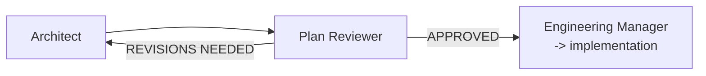

# Plan Reviewer Agent

**Source:** `src/agents/tsh-plan-reviewer.md`  
**Kind:** subagent, model tier `deep`, read-write access

The Plan Reviewer (`tsh-plan-reviewer`) is a subagent that stress-tests implementation plans before code is written. It challenges the plan for likely failure modes, hidden assumptions, sequencing traps, integration mismatches, migration and data risks, and false confidence in testing.

## Responsibilities

- Stress-testing the plan against the research context to expose likely failure modes.
- Checking that referenced files, functions, classes, integrations, and patterns actually exist in the codebase.
- Surfacing hidden assumptions, sequencing traps, dependency order issues, and migration or data risks.
- Challenging integration boundaries, rework risk, and false confidence in test coverage.
- Producing a structured approval or revision report for the Engineering Manager.

## What It Produces

- A failure-oriented review report with a binary verdict, top risks, assumptions, rework triggers, and any blocking gaps.
- The report is saved as `{task-name}.plan-review.md` alongside the plan in `specifications/<task-name>/`.

```text
specifications/
  user-authentication/
    user-authentication.research.md
    user-authentication.plan.md
    user-authentication.plan-review.md    ← new
```

## How It Works

You do not start the Plan Reviewer with a command. [`/tsh-implement`](../commands/implement) runs the Engineering Manager, which delegates to the Plan Reviewer after the Architect creates or updates a `.plan.md` file. If the plan is already approved and unchanged since the last review, the review is skipped. The Quick flow produces no plan, so it has nothing to review.

1. Reads the research file first, so the review is grounded in the original requirements.
2. Reads the plan file and checks every task, phase, and definition of done.
3. Runs challenge-domain, failure-mode, assumption, codebase-reality, and sequencing-and-feasibility passes.
4. Tries to surface 5-10 substantive risks when the plan is broad or uncertain. An unusually robust plan may produce fewer findings.
5. Saves the report as `{task-name}.plan-review.md` next to the plan. It contains the verdict, the top risks, assumptions, rework triggers, blocking gaps and a `Decision and Revision History` table.

## Severity Levels

| Severity | Definition | Action Required |
| --- | --- | --- |
| **BLOCKER** | Credible execution risk likely to cause failure, major rework, unsafe rollout, or materially wrong outcome | Plan MUST be revised before implementation |
| **WARNING** | Meaningful weakness or assumption that could cause delays or local rework | Should be addressed but does not automatically block |
| **SUGGESTION** | Lower-signal concern with practical value | Nice-to-have only |

## Tool access

- **Read-write.**
- **No shell.** Shell access is denied on Claude Code.
- **Leaf agent.** It never delegates to other agents.
- **MCP servers:** Context7, Sequential Thinking.

## Skills loaded

- `tsh-reviewing-plans` (preloaded) - Stress-test an implementation plan and write a plan-review report
- `tsh-designing-architecture` - Design the architecture and implementation plan for a task
- `tsh-analyzing-codebase` - Analyze a codebase: dependencies, business logic, duplications
- `tsh-discovering-technical-context` - Discover project conventions and patterns before coding
- `tsh-analyzing-implementation-gaps` - Compare a plan with the current state to find implementation gaps
- `tsh-designing-databases` - SQL and database design: schemas, indexing, queries, ORMs

## Invocation and modes

- **Delegated by:** the `tsh-engineering-manager` (plan review loop, maximum 3 iterations). In delegated mode the task starts with `MODE: delegated` and the agent ends its reply with a `STATUS` block instead of asking the user.
- **Direct use:** the agent runs in interactive mode and talks to you. See the invocation table in the [Agents overview](./overview#invoking-an-agent-directly).

## Verdicts and handoffs



- **`APPROVED`**: the Engineering Manager gives you a short chat summary and asks for confirmation to implement. The `*.plan-review.md` file stays unchanged.
- **`REVISIONS NEEDED` with BLOCKERs**: the Engineering Manager sends the report back to the Architect and reviews the revised plan again. After 3 iterations it stops and lets you decide.
- **Plan already approved and unchanged**: the review is skipped.
